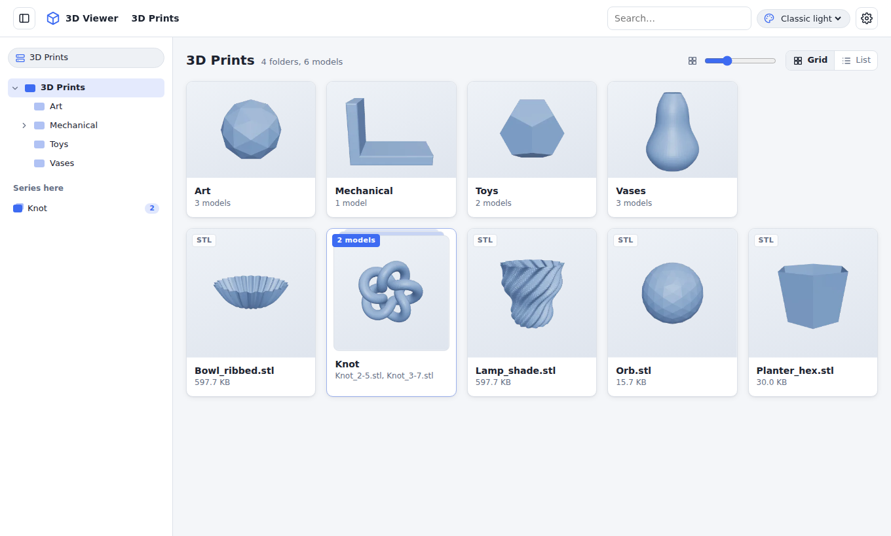
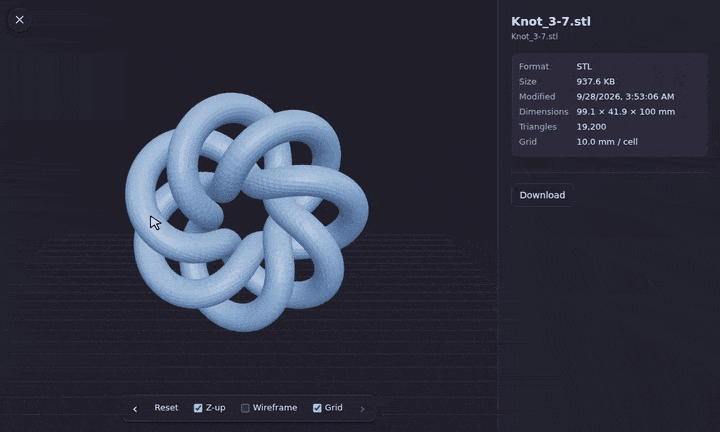
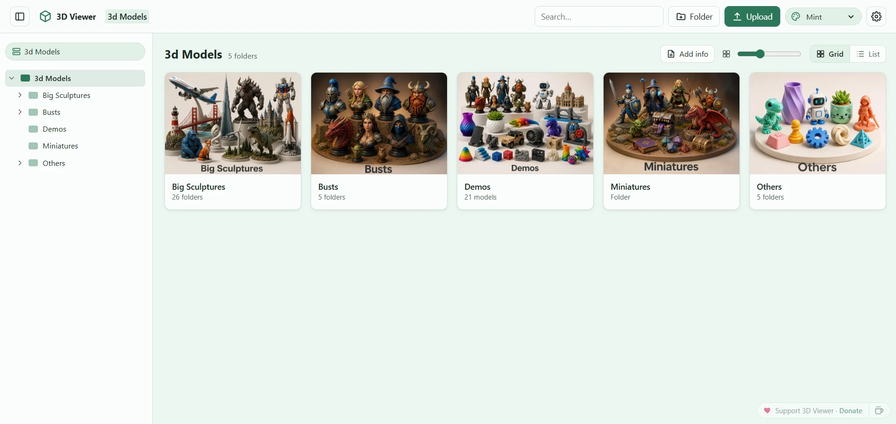
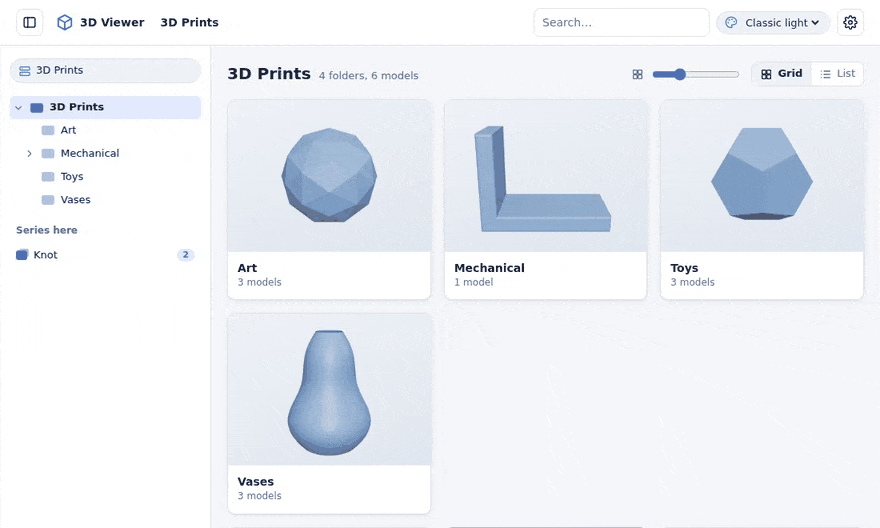
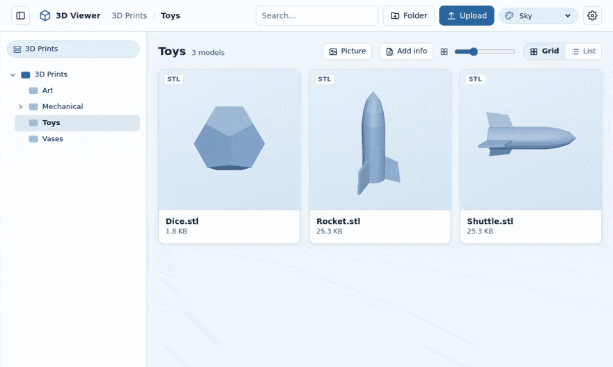
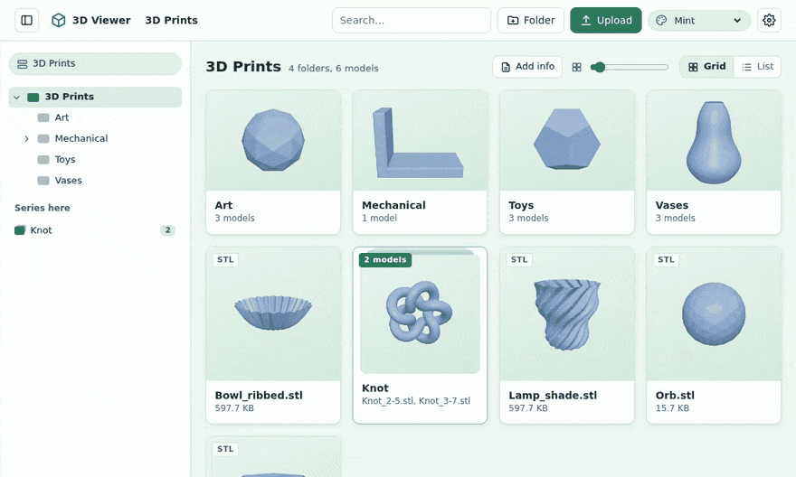

<p align="center">
  
</p>

<h1 align="center">3D Viewer</h1>

<p align="center"><b>Browse, preview and organise the 3D models on your NAS or server, from any device.</b><br>
Self-hosted with Docker · STL, 3MF, OBJ, PLY, STEP, GLB/GLTF, FBX, 3DS, DAE, USDZ, Blender, Lychee (.lys), G-code · Free<br>
Tested on <b>UGREEN</b>, <b>Synology</b> and <b>QNAP</b> NAS</p>

<p align="center">
  <a href="#install"></a>
  <a href="https://3dview.ittechshop.com"></a>
  <a href="https://buymeacoffee.com/vincentflagg"></a>
  <a href="https://short.ittechshop.com/wyiCyr"></a>
  <a href="https://github.com/VincentFlagg/3DViewer/releases/latest"></a>
</p>

## ❤️ Free for everyone, supported by you

> **3D Viewer is free. You never need to pay to use it: every feature works without a supporter key.**
>
> If you want to support our software, please make a donation of **$5**, more or less if you feel like it. Every donation, big or small, helps keep 3D Viewer growing, and it truly means a lot. **Thank you!** 🙏
>
> As a thank-you, each donation comes with a supporter key that turns off the short daily splash screen and the small reminder in the corner. Donate with PayPal or a card at [**3dview.ittechshop.com**](https://3dview.ittechshop.com), or [**buy me a coffee**](https://buymeacoffee.com/vincentflagg) and write **3D Viewer** in its message: that coffee gets a key too, emailed to the address you use on Buy Me a Coffee. Paste the key in **Admin → Supporter license**; it covers everyone using that server, works offline and never expires.

## See it in action

**Turn any model around**: orbit, pan and zoom, right in the browser.



**Your library at a glance**: every folder gets a card, with the picture you choose for it. The folder tree on the left shows the whole library.



Use the picture button on a folder's card (or **Picture** above the grid inside it) to upload a picture, or pick a picture or model thumbnail from inside the folder. Pictures are cropped to 4:3 and resized to **800 × 600**, the size a card uses, so upload pictures of that size for the sharpest result. Without a picture of its own, a folder shows one of its pictures or a model thumbnail.

**Browse and search**: folders, series of related models, folder notes and live search.



**Fix models that lie on their side**: turn once, save, and the thumbnail follows. The model file is never changed.



**Organise**: drag models into folders, upload a .zip (it unpacks into its own folder) and choose each folder's picture.



**Pick a theme**: Auto, Classic light and dark, Mint, Lavender, Peach, Sky and Dusk.


## 🎁 Free STL files

Want some models to try it out? Free STL files are available at [**short.ittechshop.com/wyiCyr**](https://short.ittechshop.com/wyiCyr). Download them into one of your libraries and they appear in 3D Viewer straight away.

## Features

- **Libraries.** Add as many folders as you like: shares on different volumes, USB drives and so on. Switch between them from the menu at the top of the sidebar.
- **Sidebar.** A folder tree of the library (expand folders in place, the current one is highlighted) and the series in the current folder. Hide it with the button at the left of the top bar; on phones it opens as a drawer.
- **Gallery.** A grid or list of every model, with folder navigation and search. The search looks through the open folder and all its sub-folders (the whole library at the top level) and matches file names, folder names, display names, descriptions, series names and your own tags; every word typed must match. Results show as one list with the folder each model is in; matching folders come first and show their folder picture or, without one, a 2×2 collage of the models in them and their sub-folders. A click opens the model in its folder, and Esc or clearing the box goes back. A slider sets the card size. **Sort by** orders the folder by name (A–Z or Z–A), date (newest or oldest first), size or type, and is remembered in your browser. **Show** narrows it to folders only, models only, models without a thumbnail, or one file type (for example only STL or only G-code); each choice shows how many there are. The folder title, its tools and the upload/unzip progress bar stay at the top while you scroll. Folders show a picture: a `cover`, `folder` or `preview` image inside them, else their first image (also from an `images/` sub-folder), else the thumbnail of the model chosen with **Use as the folder thumbnail** in the viewer, else the render of their first model. A folder's own picture always wins over a model thumbnail. A folder that only holds sub-folders (for example `Bird/With base` and `Bird/No base`) shows the picture of its first sub-folder that has one. Under its name a folder card shows what it holds, sub-folders included (for example **12 folders · 10 models · 35 files**; files are everything that is not a model). The counts are worked out in the background and remembered, so big libraries still open fast; they are checked again after every change made in the app and every few minutes for changes made outside it (over SMB, for example).
- **Folder pictures.** Admins set any folder's picture with the picture button on its card (or **Picture** above the grid when inside it): upload one, or pick a picture or model thumbnail from inside the folder or its sub-folders. The choice is previewed first, cropped as the card shows it; **View full size** (or a click on the preview) shows the whole picture with a frame on the part the card keeps: drag the frame to choose another part, drag its corners to resize it (it stays 4:3), and step through the folder's pictures and thumbnails with the arrows, the ← → keys or a swipe. **Fit to screen** (the default) enlarges or shrinks every picture to fill the screen; **Actual size** shows it at 100 %, to scroll or drag around. **Fill** (the default) crops the picture to the card with the frame; **Fit whole picture** keeps all of it and fills the empty sides of the card with **Black** or **White** borders. It is saved with **Use this picture** (**Cancel** or Esc goes back). It is cropped to 4:3, resized to 800 × 600 (never enlarged) and saved in the folder as `cover.webp` (a GIF stays `cover.gif`), replacing an earlier `cover.*`; **Remove** deletes it and the folder goes back to the automatic picture.
- **Pictures and covers.** Images next to your models (PNG, JPG, WebP, GIF, AVIF) are used as covers: `benchy.jpg` becomes the cover of `benchy.stl`. In the viewer you can pick any picture in the folder as the cover, or go back to the 3D render. The viewer also shows a strip of the model's pictures (images named after it, and images named after no model, such as a download's `images/` folder); click one to open it full size. Large pictures get a small cached copy for the grid.
- **Selecting several models and folders.** Click **Select** above the grid (or Ctrl/Cmd+click a card) and pick models or folders: click to add or remove one, Shift+click for a range, **Select all** for everything in the folder, sub-folders included. A series card selects all its models. The bar at the bottom shows how many are selected and their size, with:
  - **Download** (for everyone): one .zip of the selected files and folders (a folder with everything in it), keeping their sub-folders. There is no size limit. OBJ and GLTF models bring the files they need (`.mtl`, textures, `.bin`). A single file downloads as it is. The zip is streamed, so multi-GB selections work without filling the server's memory.
  - **Compare** (when two models are selected): opens them side by side in the viewer, on one floor and at the same scale, with the size of each. **Overlay** puts them on top of each other instead, each in its own see-through colour, to see what differs (for example two versions of a part). Measure, cross-section, print bed and screenshot work there too. **Compare with…** in the viewer does the same from one model: pick the second one from the folder or search the library for it.
  - **Move to…** and **Delete** (admin only).
- **Renaming folders.** Admins rename a folder with the pencil button on its card, or **Rename** above the grid for the folder they are in. Its models keep their notes, saved orientation, thumbnails and previews (nothing is rendered again).
- **Moving.** Admins drag a model, a series card, a folder or a selection onto a folder card, a folder in the sidebar tree or a breadcrumb link. While dragging, the sidebar also lists the other libraries: drop there to move into another library. **Move to…** (on a folder card, in the viewer and in the selection bar) opens a library and folder picker. A model takes its notes, saved orientation, thumbnail and same-name companions (an OBJ's `.mtl`, `benchy.jpg`, `benchy.txt`) along. Between libraries on the same disk a move is instant; on another disk or share it is copied and then deleted, with a progress bar. In **Move to…**, **New folder** creates a folder where you are in the picker (in any library) and opens it, so you can move into a new folder in one go. When the name is already taken, you are asked before replacing it (the one replaced goes to the trash).
- **Trash.** Deleting a file or a folder (with everything in it) moves it to a hidden `.3dviewer-trash` folder in its library, with its notes and orientation. **Admin → Trash** lists the items, restores them where they were, or deletes them for good. Items older than 30 days (Admin setting, 0 = keep until emptied) are deleted for good automatically. Deleting for good cannot be undone: the NAS recycle bin does not catch it, and other users, apps and slicers lose the files too.
- **Info panel.** A folder's `README.txt`, `notes.md` and other `.txt`/`.md` files show in a panel on the right (Markdown is formatted); a `files/` folder also shows the README of the folder above it. Notes named after a model (`benchy.txt`) show in that model's viewer panel. Admins can edit these files or add a `README.md` to any folder with **Add info**.
- **Archives: zip, RAR, 7z, TAR and compressed files.** Uploading an archive unpacks it into a new folder named after it (a single top-level folder inside it is dropped) and removes the archive. Supported:
  - `.zip`, also protected with a password;
  - `.rar` (RAR4 and RAR5), also split into parts (`Name.part1.rar`, `Name.part2.rar`… or `Name.rar`, `Name.r00`…);
  - `.7z`, also split (`Name.7z.001`, `Name.7z.002`…);
  - `.tar`, `.tar.gz`/`.tgz`, `.tar.xz`/`.txz`, `.tar.bz2`/`.tbz2`;
  - a single compressed file (`model.stl.gz`, `.xz`, `.bz2`), which is unpacked next to it as `model.stl`.

  An archive protected with a password, a split archive (its parts may arrive in separate batches) or one that cannot be unpacked is kept as it is: unpack it from its card. For safety, archives with links or with paths outside their folder are not unpacked.
- **Archives already in a library.** An archive with 3D models inside that was copied into a library (for example over SMB) shows as a card with its type (ZIP, RAR, 7Z, TAR, GZ), how many models it holds and, for a split archive, how many parts it has, and **Unpack** (admin): it is unpacked like an uploaded one, into a new folder named after it, and the archive (all its parts) goes to the trash. For an archive protected with a password, **Unpack** asks for the password (it is not kept). Several archives can be selected and unpacked with **Unpack** in the selection bar; they are unpacked one after another. **Admin → Libraries → Unpack archives** does this for every archive with models in a library, sub-folders included (archives with a password are left for you to unpack from their card). Only one archive is unpacked at a time: a second click, another admin or **Unpack archives** has to wait until it is done, so an archive is never unpacked twice. Archives without models are not shown. The unpacked size limit is **Admin → Limits**.
- **Viewer.** Models open Z-up, seen from the front; thumbnails use the same view. If a model still lies on its side or faces away, admins turn it with **Tilt**, **Turn** and **Roll** (quarter turns) in the viewer panel and **Save orientation**: it then always opens that way and its thumbnail is rendered again. **Lay flat on a face** turns the model onto the face you click next; **Auto-orient for printing** tries the model on each of its flat sides and keeps the one that needs the fewest supports (at the **Overhangs** angle), then the largest footprint. The orientation is stored in the model's `.3dviewer` metadata; the model file itself is never changed. Orbit, pan and zoom, with a Z-up toggle, wireframe, a ground grid and reset view. It shows dimensions and the triangle count.
- **Viewer tools.** In the viewer panel under **Tools**:
  - **Measure**: **Distance** (two points: the distance with its ΔX, ΔY and ΔZ parts), **Circle** (three points on the edge of a hole or a round part: radius, diameter and centre) or **Angle** (three points: the angle at the middle one), in mm or inches (Admin → Viewer defaults → Units). One more click starts a new measurement. **Snap to** picks where the points go: **Auto** (a corner nearby, else the middle of a border, else the border), **Corners** (where borders meet), **Borders** (sharp edges), **Middle of a border**, **Centre of a flat face**, **Centre of the model**, **Centre of the model's base**, or **Nothing** (exactly where you click). A ring shows where a click will land, also just outside the model's outline. The choice is remembered and can be changed between the two clicks.
  - **Cross-section**: cut through the model across its height, width or depth, with a slider for where to cut, or type the exact height (or distance from the left side or front), and **Keep the other side**. The cut face is drawn in red and hatched (**Hatched cut faces**), so wall thickness and hollow parts show.
  - **Overhangs**: faces that will need supports turn red, with an **Angle** slider (the slicer's overhang threshold, 45° by default); says how much of the surface needs supports. Faces on the bed don't count.
  - **Wall thickness**: colours the whole model by how thick its walls are (red below **Thin below**, 0.8 mm by default, then orange, yellow, green and blue as they get thicker) and labels the thinnest spots. It runs in the background, with progress, on models of up to 6 million triangles.
  - **Mesh check**: open edges (holes, orange), non-manifold edges (purple) and flipped faces (red), with their counts and the number of separate parts; a hollow inside a part is recognised as such.
  - **Weight & cost**: the model's volume, and for PLA, PETG, ABS, ASA, TPU, Nylon, PC, PLA-CF or resin the plastic used, weight, filament length (1.75 or 2.85 mm) and cost, with **Infill** and **Walls**. It is an estimate without slicing (within about 10–15 % of a slicer, without supports). The admin sets the currency and the price per kg of each material in **Admin → Print cost**; each person can change a price for themselves in the viewer.
  - **Export**: downloads the model as **STL**, **3MF** or **OBJ**, standing on the bed as shown (with an orientation you just set, saved or not). **Scale** in % or a **Height** in mm resizes it. **Repair** (on by default) closes holes, turns flipped faces the right way and removes faces with no area and faces stored twice, then says what it fixed and what is left. Admins can **Save a copy here**, next to the original (for example `benchy-fixed.3mf`); the original is never changed. Colours and textures are not exported.
  - **View in AR** (phones and tablets): the model at its real size on your table or floor, through the camera. iPhone and iPad open it in AR Quick Look; Android in Google's Scene Viewer, which downloads the model from this server, so the phone must reach the server at its address (Scene Viewer may need HTTPS).
  - **Screenshot**: saves the view as a picture. **WebP** gives the smallest file and is the default; **JPG** and **PNG** (best quality) can be picked instead, and the choice is remembered. Browsers that cannot write WebP (Safari) save a JPG.
- **Prepare for print.** Under **Prepare for print** in the viewer panel, for everyone (the result is downloaded with **Tools → Export**; the admin can also **Save a copy here**; the model file itself is never changed, and **Undo all changes** goes back to it):
  - **Best orientation**: tries the model on each side and on its flat faces and shows the three best positions, each with an estimate of its supports (in grams), its height and a rough print time. Click one to turn the model; the faces that need supports turn red. The admin keeps a position with **Save orientation**.
  - **Scale to fit**: for the chosen printer, how big the model can be with 5 % of the build volume left free (turned a quarter turn on the bed when that fits better), and **Use … % for the export**.
  - **Simplify**: keeps 10–90 % of the triangles (50 % by default), for a lighter file that slices faster, and says how far the surface moved at most.
  - **Add text**: type the text, pick a font, the letter height and the depth, **Raised** or **Engraved**, and click the model where it goes (it reads upright from where you look). Text on a curved face reaches the surface everywhere. Several texts can be added; **Undo all changes** goes back to the model as it was.
  - **Supports**: **Tree** (branches that join into trunks: less plastic, fewer marks) or **Straight** (a column under each spot) supports under every overhang, at the angle set in Tools → Overhangs, with **Touch points** of 0.4–1.0 mm and a **Density**. Shows how much plastic they take and how many stand on the model. **Tools → Export** saves them with the model, as their own part (in a 3MF, or a file of their own with **One file per part**). They are for the model as it stands: turn it first. Your slicer can still make its own supports instead.
  - **Split**: cut the model across its height, width or depth wherever you like (drag the cut or type it in mm), or **Cut to fit the printer** chosen in Scale to fit: as few cuts as make every part fit. The parts are joined with **Round pegs**, **Keyed pegs** (with a flat side, so they fit one way only), **Dowel holes** (holes in both parts and loose dowels to print, or for metal pins or magnets) or **No pegs**, with a **Gap** of 0.1–0.4 mm. The parts show apart, each in its own colour; **Tools → Export** saves them as one 3MF with each part separate, or **One file per part** in a .zip.
- **Print bed.** Tools → **Print bed** shows a printer's build volume around the model (Bambu Lab, Prusa, Creality, Elegoo, Anycubic, Voron, resin printers, or a custom size) and says whether the model fits, fits after a quarter turn, or by how much it is too big. The printer is remembered.
- **Open in slicer.** For STL, 3MF, OBJ, PLY and STEP files, **Open in Bambu Studio** (or OrcaSlicer, PrusaSlicer, Creality Print, UltiMaker Cura: pick it in the list next to the button, it is remembered) opens the model in the slicer installed on your computer. Creality Print (6 or later) is in the list too. The slicer downloads the file from 3D Viewer, so it has to reach the server at the address in your browser.
- **Thumbnail view.** To show a model from another angle in its thumbnail, admins turn the view with the mouse (or a finger) and click **Use this view** in the viewer panel: the thumbnail is rendered again from that angle, and the model opens from it. With the sun lamp on, the thumbnail gets the same light and shadows. **Front view** goes back to the standard view and even light.
- **Sun lamp.** In the viewer panel, **Light → Sun lamp** replaces the even lighting with one strong light that casts shadows on the model and the floor, which brings out shape and fine detail. **Front**, **Left**, **Right**, **Back** and **Top** move it; **Around** and **Height** set any direction. The setting is remembered in your browser; to give a thumbnail the sun's light and shadows, click **Use this view** while it is on.
- **Lychee Slicer scenes (.lys).** Supported resin prints open with all their models placed as in Lychee, and their supports rebuilt as light-grey struts, pads and braces. The **Supports** button in the viewer hides them to see the model alone; thumbnails show the supported scene. A scene that uses one of Lychee's own sample models doesn't contain the model, so it shows Lychee's preview picture instead.
- **G-code (.gcode) and Prusa binary G-code (.bgcode).** The toolpaths of a sliced print as solid, shaded strands (the width and height of each printed line), so the part looks like the print, coloured by feature (outer and inner walls, infill, top and bottom surfaces, bridges, supports, skirt…). In the viewer panel: **Solid** or **Lines** (lines are lighter for very large files, which open as lines), **By feature** or **One colour** (the model colour), and a tick box per feature to hide it, for example infill and inner walls to see only the outside. A **Layer** slider shows the print up to any layer, **Travel** shows the moves where the printer does not print, and the panel lists layers, layer height, print time, filament and the slicer. Thumbnails use the preview picture the slicer saves in the file (PrusaSlicer, OrcaSlicer, Bambu Studio, Cura with a thumbnail plugin); files without one get a render of the toolpaths.
- **ZBrush and 123D Catch files (.ztl, .zpr, .3dp).** These formats are not published (and Autodesk 123D Catch was shut down in 2017; its `.3dp` projects only point to photos and a mesh stored elsewhere), so they cannot be shown in 3D. They appear in the gallery with their own icon so a model folder shows everything in it: click one to download it, or select, move and delete them like models. For a preview, export the model as STL or OBJ and keep it next to the original. To hide them, untick **Admin → Viewer defaults → Show ZBrush and 123D Catch files**.
- **CAD files (STEP .step/.stp, IGES .iges/.igs).** Shown like any model, with a thumbnail and the colours stored in the file. OpenCascade (as WebAssembly, in the browser) turns their surfaces into a mesh; for big files the server keeps a compressed preview, so they open fast the next time. A file that is all black (the default of many CAD programs) is shown in the model colour.
- **3DS, COLLADA (.dae) and USD (.usdz, .usd, .usda, .usdc).** Shown with their materials and textures. COLLADA and USD files say which way is up and are turned to match; 3DS files are shown Z-up.
- **Blender files (.blend).** 3D Viewer reads the meshes stored in a `.blend` (Blender 2.8 to 4.x, also compressed files) and shows them like any model, with a thumbnail:
  - the mesh objects of the scene, where they are placed, with their material colour, or the base colour texture when it is packed in the file (with its UV map);
  - copies made by particle systems (trees, grass, rocks) and by instanced collections. Particles that Blender places when the file is opened are spread over the emitter here in the same number and size, but not at the same spots; a colour ramp in the material (leaves by season) gives each copy its own colour;
  - not shown: modifiers and geometry nodes (the mesh is shown as modelled), textures that are not packed, curves, text and metaballs. A file without any mesh shows the preview picture Blender saved in it.
  Blender files are shown Z-up, in Blender units as millimetres.
- **Series / groups.** Models whose names share a first word (`Dragon_head.stl`, `Dragon_body.stl`, `dragon-wing-L.stl`) are grouped into one stacked card automatically. You can rename a group, ungroup it, move a model into any group (one click opens a searchable list of the folder's groups, where you can also type a new name), or exclude a model from grouping. To choose which model's picture a series card shows, open that model and click **Use as the series thumbnail**.
- **Fast thumbnails and previews.** The server renders every thumbnail in the background with a headless browser, on the GPU when one is passed to the container and on the CPU otherwise. Large models also get a compressed preview (welded and meshopt-compressed GLB, often 10–20× smaller) that the viewer loads instead of the original. Downloads always give you the original file.
- **Install as an app.** **Install app** (the phone icon at the top) installs 3D Viewer on a computer, phone or tablet: it gets its own icon on the desktop, dock or home screen and opens in its own window, without the browser's bars. Where the browser cannot install it from the page, the button explains how: on iPhone and iPad, Share → **Add to Home Screen** (works over http too); Chrome, Edge and Android only install apps from an **https://** address, so open 3D Viewer through your NAS's reverse proxy with a certificate, Tailscale or a tunnel (on a computer, Chrome's **Create shortcut… → Open as window** also works over http). The icon is a shaded 3D cube or a flat 2D one (**Admin → Install as an app**); the browser tab and the logo use it too. When the server cannot be reached, the app shows a short message instead of an error page.
- **Themes.** Pick a colour theme from the palette menu in the top bar: Auto (follows your system's light/dark setting), Classic light, Classic dark, the pastel Mint, Lavender, Peach and Sky themes, or Dusk (pastel accents on a dark background). The choice is saved in your browser.
- **Admin page** (`/admin`, password protected), in tabs: **Library**, **Accounts**, **Printing**, **Viewer**, **Thumbnails**, **Notifications**, **Backup** and **Support & ideas** (on a phone, a row of tabs at the top; `/admin#accounts` opens a tab directly):
  - Libraries: add, rename, change the folder, reorder, remove, unpack every zip with models.
  - Network shares: connect SMB/NFS shares on other NAS devices or computers and use them as libraries.
  - Thumbnails and previews: renderer status (GPU or CPU), queue, cache size, render missing, clear the cache, and how often the libraries are looked through for new files (every 1, 3, 6 or 12 hours, or once a day at a set time, for example at night).
  - Storage: the space used by thumbnails, previews and each library's trash, with the free space of the cache folder, the data folder and every library, and a warning when one is almost full.
  - Limits: largest upload, largest unpacked .zip and largest model to make a thumbnail for (see [Size limits](#size-limits)).
  - Trash: restore deleted files and folders, delete them for good, empty the trash, and how many days deleted items are kept.
  - Viewer defaults: model color, units (mm / in), which formats are Z-up, automatic grouping on or off, ZBrush and 123D Catch files shown or hidden.
  - Install as an app: the app icon (3D or 2D).
  - Import from link: the Thingiverse app token.
  - Share links: every link that works, who made it and until when, with **Remove**.
  - Duplicates: finds models stored more than once, in any folder or library (the same contents, whatever their names), with **Keep only this one** and **Delete** to send extra copies to the trash.
  - Accounts: add accounts, give them a new password or remove them, and make the server private.
  - Backup: download one file with all the settings (libraries, shares, settings, admin password, accounts with their favourites, tags and print logs, supporter key) and restore from it, for example on a new NAS.
  - Accounts: also **Can print** for each account, two-factor sign-in (required for everyone or not; **Reset 2FA** for an account that lost its phone).
  - Single sign-on: an OpenID Connect provider (issuer URL, client ID and secret), and whether accounts are made on first sign-in.
  - Notifications: what to send a message about, the public address used in links, and the Telegram, Discord, e-mail, ntfy and Gotify settings.
  - Printers: add, change, test and remove the printers that sliced files can be sent to.
  - API tokens: every token people made, with **Remove**.
  - Automatic backups: on or off, every day or week, at what time, how many to keep, and the folder.
  - Access: turn editing on or off, change the admin password.
- **Accounts.** The admin adds accounts on the Admin page. People sign in with the person button at the top of the main page and get their own:
  - **Favourites**: ☆ **Favourite** in the viewer; a star on the card;
  - **Tags**: type a tag under **Mine** in the viewer (Enter adds it; your earlier tags are suggested);
  - **Print log**: **+ Add a print** with the date, the filament or resin, notes and a photo (made small in your browser).
  The sidebar lists **My favourites**, **My prints** and each tag across all libraries, and **Show** above the grid can narrow a folder to them. Marks follow a model when it is moved or its folder renamed in the app. Accounts can look at and download models, make share links and import from a link; everything else that changes the library is for the admin. Each account can change its own password from the person menu. The admin signs in on the main page as **admin** with the admin password, and has favourites, tags and a print log too.
- **Private server.** With **Admin → Accounts → Private** on, only signed-in accounts and the admin see the libraries; everyone else gets the sign-in form (or only what a share link opens).
- **Share links.** Signed-in accounts and the admin click **Share link** in the viewer or **Share** above a folder and pick how long the link works: 1 day, 7 days, 30 days or until removed. Anyone with the link sees only that model (in the viewer) or that folder and its sub-folders, without the sidebar or the rest of the library, and can view, search inside it and download, also on a private server and without an account. The dialog lists the links already made for the model or folder, with **Copy** and **Remove**; **Admin → Share links** lists them all. Links keep working when the model or folder is moved or renamed in the app.
- **Import from link.** Signed-in accounts and the admin click **Import** at the top and paste a link; it goes into the folder that is open:
  - a model page on **Printables**, **Thingiverse** or **MakerWorld**: a new folder named after the model with its files (archives unpacked), its first picture as the folder picture, the other pictures in `images/`, and a `README.md` with the description and the link it came from. Thingiverse needs an app token (free, Admin → Import from link). MakerWorld only lets signed-in members download files, so from MakerWorld usually only the pictures and description come in, with a note to download the 3MF there and upload it;
  - a link straight to a file (.stl, .3mf, .zip…): saved in the folder, archives unpacked like an upload.
  The server downloads it in the background (the dialog shows the progress), with the upload size limit per file. Accounts cannot import from addresses on the local network; the admin can. Sites change how they answer from time to time; when one does, the error says to download there and upload instead.
- **Recently added.** In the sidebar for everyone: the newest models of all libraries, by the date of the file.
- **Statistics.** Signed-in accounts and the admin open **Statistics** in the sidebar: how many models and how much space, models added and opened and prints logged per month (as bar charts, each also as a table), models by type and by library, the largest models, and the most opened and most printed ones.
- **To print.** A shared list of what to print next, for signed-in accounts that may print (the admin chooses who, see below). **+ To print** in the viewer adds a model with how many copies, the material and a note; the list in the sidebar (with a count) can be reordered, **Printed ✓** counts one copy off and adds it to your print log, and sliced files can be sent to a printer from it.
- **Send to printer.** Sliced files (G-code, `.bgcode` or a sliced 3MF) can be sent to a 3D printer on your network from the viewer or the To print list, and started right away if you like. Each printer shows whether it is free or printing. Supported:
  - **Klipper** printers through **Moonraker** (Mainsail, Fluidd), and **Creality** K1, K2, Hi and Ender-3 V3 with Moonraker reachable (rooted, or firmware that opens it);
  - **OctoPrint**, with an API key;
  - **Prusa** MK4, XL, MINI and Core One through **PrusaLink** (user and password from the printer, or an API key);
  - **Bambu Lab** X1, P1 and A1 in **LAN mode** (IP address, serial number and LAN access code). Send a 3MF saved with “Export plate sliced file”.

  The admin adds printers in **Admin → Printers** (with **Test connection**) and ticks **Can print** for each account allowed to use them.
- **3MF plates and colours.** For 3MF projects from Bambu Studio, OrcaSlicer and PrusaSlicer, the viewer lists the plates (show one at a time or all) and the filament colours with their material, and colours the objects as the slicer does. For large models it first shows the optimized preview: **Show plates and colours** loads the full file.
- **Similar models.** The viewer lists models that look like the open one, from the whole library, with how alike they are (in %): copies saved under another name, other versions and remixes. The server works out the shape of every model in the background, after the thumbnails; it does not depend on names, size, position or how a model is turned.
- **Editing many models at once.** Select models (or folders, for everything in them) and click **Edit…**: set or clear the series, replace or add to the description, set the licence (admin), and add or remove your own tags (everyone signed in).
- **Licence.** Each model can carry a licence (for example CC BY-NC 4.0), shown in the viewer and editable with the description.
- **Notifications.** **Admin → Notifications** sends a short message when new models turn up (uploaded, imported or copied in), an import from a link finishes, someone opens a share link, or a scheduled backup fails. Turn on one or more ways: **Telegram**, **Discord**, **e-mail** (any SMTP server), **ntfy** and **Gotify**, each with **Send a test**. Messages that come at the same time are sent together.
- **Two-factor sign-in.** Anyone can turn on two-factor sign-in for themselves in the person menu at the top (the admin too): scan the code with an authenticator app (Google Authenticator, Microsoft Authenticator, Authy, 1Password…), and signing in then also asks for its 6-digit code. Eight recovery codes, each usable once, are given for a lost phone. The admin can require it for every account (each sets it up the next time they sign in) and can turn it off for an account that lost its phone. A lost admin phone: set `ADMIN_RESET_2FA=true` in the container settings once.
- **Single sign-on.** People can sign in with your login provider (Authelia, Authentik, Keycloak, Zitadel, Pocket ID… anything with OpenID Connect) as well as with a user name and password. Set it up in **Admin → Single sign-on**: the issuer URL, client ID and secret of an application you add in the provider, with the redirect URI shown there. Accounts are made the first time someone signs in, unless you turn that off.
- **API tokens and Home Assistant.** Signed-in accounts and the admin make tokens in the person menu → **API tokens**, read-only or with full access, for scripts and Home Assistant (see [Home Assistant and the API](#home-assistant-and-the-api)). A token acts as the person who made it; the admin sees and can remove every token.
- **Automatic backups.** **Admin → Backup → Automatic backups** saves the settings backup into a folder every day or every week (on Sunday) at a set time, and keeps as many as you choose (14 by default), deleting older ones. Pick a folder on another disk or a network share. **Back up now** makes one at once.
- **Languages.** The app is in **English** and **Spanish** (Español). It follows your browser's language; the globe button at the top changes it for this browser. Names, descriptions and notes stay as they were written. See [Languages and translations](#languages-and-translations) to correct a translation or add a language.
- **Viewing and downloading are open to everyone** (unless the server is private). **Changes need the admin login:** upload, new folder, rename, move, delete, restore from the trash, and editing names, descriptions and groups (signed-in accounts can import from a link and make share links).
- Names, descriptions and groups are stored next to each model in a `.3dviewer/` folder:
  ```
  Prints/
  ├── benchy.stl
  └── .3dviewer/
      └── benchy.stl.json   { "title": "...", "description": "...", "group": "..." }
  ```

## Home Assistant and the API

Make a token in the person menu → **API tokens** (a read-only one is enough to read numbers) and send it as `Authorization: Bearer <token>`. `GET /api/stats/summary` returns:

```json
{ "models": 1234, "size_bytes": 52428800000, "size_gb": 52.43, "libraries": 3,
  "added_7d": 12, "added_30d": 40, "views_30d": 310, "prints_30d": 9, "prints_total": 152, "version": "4.0.0" }
```

A Home Assistant sensor (`configuration.yaml`; put the token in `secrets.yaml`):

```yaml
rest:
  - resource: http://192.168.1.10:3000/api/stats/summary
    headers:
      Authorization: !secret threedviewer_token   # "Bearer 3dv_..."
    scan_interval: 900
    sensor:
      - name: "3D Viewer models"
        value_template: "{{ value_json.models }}"
        unit_of_measurement: "models"
      - name: "3D Viewer added this week"
        value_template: "{{ value_json.added_7d }}"
      - name: "3D Viewer library size"
        value_template: "{{ value_json.size_gb }}"
        unit_of_measurement: "GB"
```

The same token works for the other `/api/...` calls the app makes (for example `/api/stats`, `/api/queue`, `/api/printers`). A read-only token can only read; a full-access token can also change things, as its owner could.

## Languages and translations

3D Viewer speaks **English** and **Spanish**. More languages can be added without a new feature release: each language is one file of texts.

- **A wrong or clumsy translation?** [Open a translation issue](https://github.com/VincentFlagg/3DViewer/issues/new?template=translation.yml) with the text as it is now, where you saw it, and how it should read.
- **Want 3D Viewer in your language?** Open a translation issue too and say which language. To translate it yourself, open `http://<your-server>/i18n/es.json` from your own 3D Viewer: it lists every English text with its Spanish translation; write yours in place of the Spanish ones and attach the file to the issue.
- **A text still in English?** In the browser's developer console, `__i18nMissing()` lists the texts on the page that have no translation yet; paste them into the issue.

Everyone who helps is thanked in the release notes.

## 💡 Ideas and bug reports

- **Have an idea?** Post it in [Ideas](https://github.com/VincentFlagg/3DViewer/discussions/categories/ideas), or 👍 an idea that is already there: the most wanted ones are built first.
- **Found a bug?** [Report it](https://github.com/VincentFlagg/3DViewer/issues/new?template=bug_report.yml) with your 3D Viewer version and NAS; a screenshot or the model that fails helps a lot.
- **A specific feature request?** [Open a feature request](https://github.com/VincentFlagg/3DViewer/issues/new?template=feature_request.yml).
- **A question on setting it up?** Ask in [Discussions](https://github.com/VincentFlagg/3DViewer/discussions).

You need a free GitHub account to post. The Admin page has the same links under **Ideas and bug reports**.

## Tested platforms

3D Viewer is tested on the following NAS systems. It also runs on any Linux server or PC with Docker (amd64 or arm64).

| NAS | Operating system | Install with | Where your files are |
|---|---|---|---|
| **UGREEN** (DXP series) | UGOS Pro | Docker app or Dockhand (Compose project) | `/volume1`, `/volume2`, …; USB drives in `/mnt/@usb`; remote folders in `/mnt/@remote` |
| **Synology** | DSM 7.2 or later | Container Manager → **Project** | `/volume1`, `/volume2`, …; USB drives in `/volumeUSB1/usbshare` |
| **QNAP** | QTS 5 / QuTS hero | Container Station → **Applications** | `/share/<shared folder>` (add `/share` to the volumes and `BROWSE_ROOTS`, see below) |

GPU-accelerated thumbnail rendering works on models with an Intel CPU (they provide `/dev/dri`). Other models render on the CPU.

<a id="install"></a>
## Install with Docker Compose

The image `ghcr.io/vincentflagg/3dviewer:latest` runs on amd64 and arm64. Download [**docker-compose.yml**](docker-compose.yml), or copy it from here:

```yaml
services:
  3dviewer:
    image: ghcr.io/vincentflagg/3dviewer:latest
    container_name: 3DViewer
    ports:
      - "8733:3000"
    environment:
      - PORT=3000
      - PUID=${PUID:-1000}
      - PGID=${PGID:-1000}
      - BROWSE_ROOTS=${BROWSE_ROOTS:-/volume1,/volume2,/volume3,/volume4,/mnt/@usb,/mnt/@remote}
      - ADMIN_PASSWORD=${ADMIN_PASSWORD:-}
      - SESSION_COOKIE_SECURE=${SESSION_COOKIE_SECURE:-false}
      - READ_ONLY=${READ_ONLY:-false}
    cap_add:
      - SYS_ADMIN
      - DAC_READ_SEARCH
    security_opt:
      - apparmor:unconfined
    devices:
      - /dev/dri:/dev/dri
    volumes:
      - /volume2/docker/3dviewer/data:/app/data
      - /volume1:/volume1
      - /volume2:/volume2
      - /mnt/@usb:/mnt/@usb:rslave
      - /mnt/@remote:/mnt/@remote:rslave
    healthcheck:
      test: ["CMD", "node", "/app/healthcheck.js"]
      interval: 30s
      timeout: 10s
      start_period: 60s
      retries: 3
    restart: unless-stopped
```

1. Create a new Compose project and paste the file: **Dockhand** or the **Docker** app on UGREEN, **Container Manager → Project** on Synology, **Container Station → Applications** on QNAP. Change the `/app/data` volume to a folder that exists on your NAS (for example `/volume1/docker/3dviewer/data`, or `/share/Container/3dviewer/data` on QNAP), then deploy.
2. Open `http://<nas-ip>:8733/admin` and create the admin password. (Or set `ADMIN_PASSWORD` in the stack's environment; that also resets a forgotten password.)
3. Click **Add library**, then browse or search for the folder that holds your models and click **Use this folder**. Repeat for each share or drive.
4. Open `http://<nas-ip>:8733` to browse the library. Thumbnails appear as the server renders them. The Admin page shows the progress.

### Synology and QNAP notes

- **Synology:** keep the `/volume1`, `/volume2` lines that match your volumes and remove the `/mnt/@usb` and `/mnt/@remote` lines (they are UGREEN paths). For USB drives, add `- /volumeUSB1:/volumeUSB1:rslave` and add `/volumeUSB1` to `BROWSE_ROOTS`.
- **QNAP:** shared folders live under `/share`. Replace the volume lines with `- /share:/share:rslave`, set `BROWSE_ROOTS=/share`, and remove the `/mnt/@usb` and `/mnt/@remote` lines. USB drives also appear under `/share` (for example `/share/USBDisk1`).
- **Permissions:** set `PUID` and `PGID` to the user that owns your model folders (run `id <username>` over SSH). On Synology the first user is usually `1026:100`; on QNAP the admin user is `0:0` and regular users start at `500:100`.
- If the container won't start because of `/dev/dri`, remove the `devices` lines: the model has no GPU device and renders on the CPU instead.

### Network shares

- Connect the share on the NAS first. In UGOS, add it as a remote folder in the **Files** app (SMB/NFS/WebDAV). UGOS mounts remote folders under `/mnt/@remote/…`.
- The `/mnt/@remote:/mnt/@remote:rslave` volume passes every remote folder into the container, including ones connected later.
- On the Admin page, click **Add library** and search or browse for it. Remote folders show with a readable name such as **SMB · 192.168.0.74**.
- If a remote NAS is offline, its library shows **Folder not found** until it's back.

**Or connect shares directly in 3D Viewer** (Admin → **Network shares** → **Add share**):
- Enter SMB (Windows / NAS share) or NFS details: host or IP, share name or export path, and a username and password (SMB). You can also pick a protocol version and read-only. The app mounts the share and can add it as a library in one step.
- Shares reconnect automatically when the container starts and are retried every 5 minutes, for example if the other NAS was still booting. The Admin page shows the status (Connected / Not connected with the reason) and has Connect, Disconnect, Edit and Remove buttons.
- How it works: the container starts a small root helper that only mounts and unmounts shares; the web app itself runs as `PUID:PGID`. This needs `cap_add: SYS_ADMIN` and `DAC_READ_SEARCH` plus `security_opt: apparmor:unconfined`.
- **Security note:** `SYS_ADMIN` is a broad privilege. If you only use shares connected in UGOS, remove the `cap_add` and `security_opt` lines, or set `DISABLE_REMOTE_MOUNTS=true`.
- Passwords are stored in `/app/data/config.json`, readable only by the app user. At mount time they are passed through a temporary credentials file, not on the command line.

### External / USB drives

- UGREEN's UGOS usually mounts USB drives under `/mnt/@usb/<device>` (for example `/mnt/@usb/sdc1`). To confirm the path, SSH into the NAS and run `ls /mnt/@usb`.
- The `/mnt/@usb:/mnt/@usb:rslave` volume makes every connected drive visible to the app. Thanks to `rslave`, drives plugged in later show up without restarting the container. Add a drive's folder as a library on the Admin page.
- Libraries on a drive that is unplugged show **Folder not found** on the Admin page until the drive is back.
- For any other location, add a volume with the same path on both sides, for example `- /volume3:/volume3`, and make sure the path is in `BROWSE_ROOTS`. `/volume1`–`/volume4` are already listed, and volumes that aren't mounted are ignored.
- On a Synology NAS, USB drives are under `/volumeUSB1/usbshare`; on a QNAP NAS, under `/share` (for example `/share/USBDisk1`).

### GPU rendering

- With `devices: - /dev/dri:/dev/dri`, the renderer tries the GPU first (Vulkan, then OpenGL ES through Mesa). If neither works, it falls back to the CPU (SwiftShader). The Admin page shows which one is in use and the GPU's name.
- UGREEN DXP, Synology and QNAP models with an Intel CPU (for example N100, Celeron J4125, i3/i5) expose `/dev/dri`.
- If the container fails to start with an error about `/dev/dri`, your NAS has no GPU device: remove the `devices` lines.
- `RENDER_GPU=off` forces CPU rendering. `RENDER_GPU=force` accepts a software GPU.

### Updating

Every version is listed on the [**Releases**](https://github.com/VincentFlagg/3DViewer/releases) page with what changed (also in the [CHANGELOG](CHANGELOG.md)). `:latest` always has the newest version; to stay on one version, use its number instead, for example `ghcr.io/vincentflagg/3dviewer:1.0.0`.

Pull the new image and redeploy the project in Dockhand, Container Manager or Container Station, or run `docker compose pull && docker compose up -d`, then hard-refresh your browser (Ctrl+Shift+R, or Cmd+Shift+R on a Mac). Your libraries, settings, notes and thumbnails are kept.

## Size limits

Three limits protect a small NAS from files that are too big to handle. Change them on the **Admin page → Limits** (no restart needed), or set them in `docker-compose.yml`. A value set in `docker-compose.yml` wins and shows locked on the Admin page. Sizes are in MB: 1024 MB = 1 GB.

| Admin page | Variable | Default | What it limits |
|---|---|---|---|
| Largest file to upload | `MAX_UPLOAD_MB` | `1024` (1 GB) | One uploaded file. Folders are sent in parts, so their total size has no limit. |
| Largest unpacked archive | `MAX_UNZIP_MB` | `8192` (8 GB) | Everything inside one archive (.zip, .rar, .7z, .tar.gz…) together. A bigger archive is kept as it is, not unpacked. |
| Largest model to make a thumbnail for | `MAX_RENDER_MB` | `1024` (1 GB) | Bigger models still open in the viewer, but get no server thumbnail. |

The defaults fit almost every model: a 120 MB model uploads and gets a thumbnail without changing anything. Making a thumbnail needs roughly 3 to 5 times the file size in memory, so on a NAS with 4 GB of RAM keep the thumbnail limit at 1024 MB or less. The app log lists the limits in use at every start.

## Thumbnail and preview cache

Thumbnails and compressed previews are kept in the data folder (`/app/data/thumbs` and `/app/data/previews`). Previews of large libraries can take several GB. To keep them on another disk or share, add a volume for them and point `CACHE_DIR` to it in `docker-compose.yml`:

```yaml
    environment:
      - CACHE_DIR=/cache
    volumes:
      - /volume2/docker/3dviewer/data:/app/data
      - /volume3/3dviewer-cache:/cache
```

At the next start the thumbnails and previews already made are moved there (the log shows how many), so nothing has to be rendered again. Settings stay in the data folder. The Admin page (Thumbnails and previews → Stored in) shows the folder in use and its size. The start-up checklist shows the free space of the cache folder and warns when `CACHE_DIR` is not on a volume, because then the cache is lost when the container is recreated.

If the cache folder runs out of space or reaches its quota (the log says *Cache folder … is full*), 3D Viewer keeps working: the move stops at the first file that does not fit, and the thumbnails and previews that were not moved stay in the data folder and are still used from there. While the cache is full, new thumbnails are saved in the data folder and no new previews are made (the viewer opens the original file). **Admin → Storage** shows what is where. Give the cache more room and restart, and the rest is moved.

## Configuration

| Variable        | Default          | Description                                                   |
|-----------------|------------------|---------------------------------------------------------------|
| `PORT`          | `3000`           | Port the server listens on inside the container.              |
| `PUID` / `PGID` | `1000` / `1000`  | User and group the app runs as, and the owner of the files it writes. They need write access to your libraries for uploads and notes. |
| `BROWSE_ROOTS`  | `/volume1…4,/mnt,/media,/models,/data` (the ones that exist) | Folders the Admin page may browse when adding libraries. |
| `ADMIN_PASSWORD`| unset            | Sets the admin password at startup (also resets a forgotten one). |
| `ADMIN_RESET_2FA` | unset | `true` turns off the admin's two-factor sign-in at startup, for a lost phone. Remove it again afterwards. |
| `SESSION_COOKIE_SECURE` | `false`  | Set to `true` when serving over HTTPS.                        |
| `READ_ONLY`     | `false`          | `true` locks all changes (upload, delete, editing), even for the admin. |
| `MAX_UPLOAD_MB` | `1024`           | Largest uploaded file in MB. Also on the Admin page; see [Size limits](#size-limits). |
| `MAX_UNZIP_MB`  | `8192`           | Largest unpacked archive in MB. Also on the Admin page; see [Size limits](#size-limits). |
| `MAX_RENDER_MB` | `1024`           | Largest model in MB that gets a server thumbnail. Also on the Admin page; see [Size limits](#size-limits). |
| `RENDER_GPU`    | `auto`           | `auto`, `off` (CPU only) or `force`.                          |
| `DISABLE_SERVER_RENDER` | `false`  | Turns off the server renderer completely; browsers render thumbnails instead. |
| `DISABLE_REMOTE_MOUNTS` | `false`  | Turns off the root mount helper (no Network shares on the Admin page). |
| `AUTH_USER` / `AUTH_PASS` | unset  | Optional HTTP basic auth in front of the whole site.          |
| `MODELS_DIR`    | unset            | Optional folder added as the first library on first start.    |
| `DATA_DIR`      | `/app/data`      | Settings (`config.json`), thumbnails and previews.            |
| `CACHE_DIR`     | `DATA_DIR`       | Thumbnails and previews, to keep them on another disk. See [Thumbnail and preview cache](#thumbnail-and-preview-cache). |

Libraries, viewer defaults and the other settings are changed on the Admin page and stored in `/app/data/config.json`.

## Logs and troubleshooting

Open the container's log: **Logs** in Dockhand, Container Manager or Container Station, or `docker logs 3dviewer`. Each start (and automatic restart) prints the 3D Viewer logo and a checklist: web server, data folder, cache folder (when `CACHE_DIR` is set), each library, network shares, thumbnail renderer (GPU or CPU), upload limits, admin password and supporter license. After that, one dated line per event: uploads (files, size, folder), unpacked zips, moves, deletes, new folders, library and settings changes, sign-ins, thumbnails made or failed, and every error with its reason.

- **"Upload failed: the connection … was lost"**: the log says how far the upload got. Common causes: a reverse proxy in front of 3D Viewer with an upload size limit (in Nginx or Nginx Proxy Manager, set `client_max_body_size 0;` or a large value), or the network dropping. Files larger than the upload limit (Admin → Limits) are skipped before uploading, with a message.
- **Uploading folders**: drag folders onto the page, or use **Upload → Upload a folder…**. The folder structure is kept.

## Notes

- Every format opens Z-up by default. You can change this on the Admin page, per model in the viewer toolbar, or save a model's orientation in the viewer.
- Lychee supports are rebuilt from the scene's settings, so they look close to Lychee's but are not an exact copy. To print, open the `.lys` in Lychee Slicer.
- Scenes from older Lychee versions (3.5.1 and before) open too.
- G-code features (for the colours and the tick boxes) are read from the slicer's comments (`;TYPE:` in PrusaSlicer, OrcaSlicer and Cura, `; FEATURE:` in Bambu Studio); G-code without them is drawn in one colour.
- Dimensions are shown as **W** (width, left to right) × **D** (depth, front to back) × **H** (height, bottom to top), as the model stands in the viewer. They assume the model is in millimetres, as is standard for 3D printing. Choose inches on the Admin page to convert them.
- For OBJ files, the matching `.mtl` file and any textures must be in the same folder, as the OBJ's `mtllib` line names them. GLTF files need their `.bin` and texture files in the same way.
- Files and folders whose names start with `.` or `@` are hidden, which also hides NAS system folders such as `@eaDir`. `#recycle` folders are hidden too.

## License

3D Viewer is **freeware**: free to use, all rights reserved. You may run the official Docker image on as many of your own machines as you like, for personal or business use. You may not copy, modify, redistribute, resell or reverse engineer it, or remove the supporter splash or reminder. The full terms are in [LICENSE](LICENSE). Third-party components included in the image keep their own licenses.
