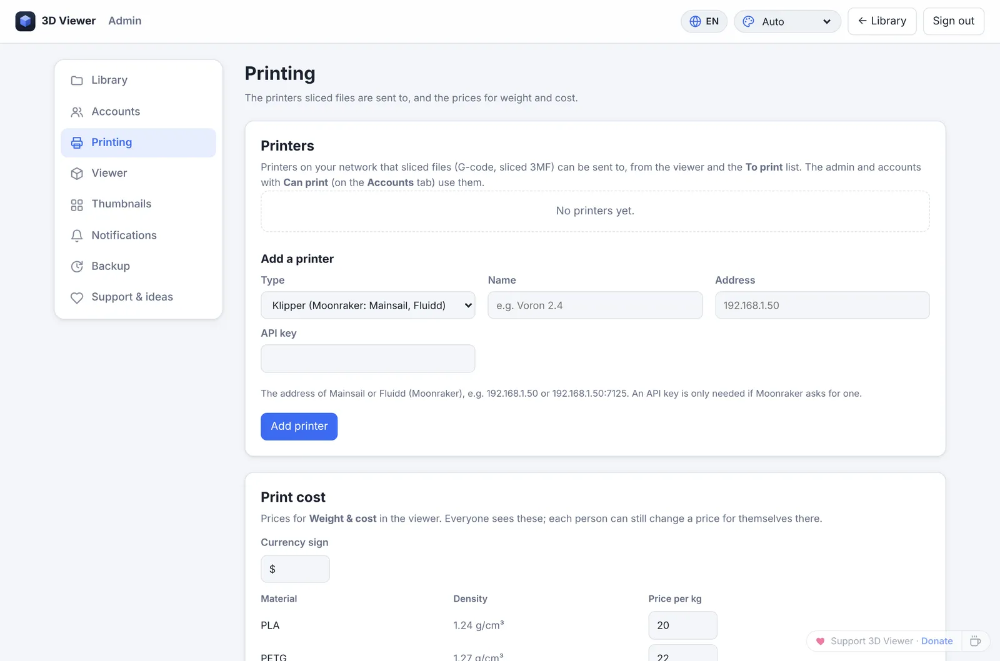

The Admin page is at `/admin` and needs the admin password. It is split into tabs; on a phone they are a row at the top. `/admin#accounts`, `/admin#thumbs` and so on open a tab directly.

## Library

- **Libraries**: add, rename, change the folder, reorder and remove libraries. **Unpack archives** unpacks every archive with models in a library. See [Gallery and browsing](Gallery-and-Browsing#libraries).
- **Network shares**: connect SMB or NFS shares on other NAS or computers and use them as libraries. See [Network shares and USB drives](Network-Shares-and-USB-Drives).
- **Trash**: restore deleted files and folders, delete them for good, empty the trash, and how many days deleted items are kept (30 by default, 0 = until emptied). See [Organising files](Organising-Files#trash).
- **Duplicates**: finds models stored more than once, in any folder or library (the same contents, whatever their names), with **Keep only this one** and **Delete** to send extra copies to the trash.
- **Import from link**: the Thingiverse app token. See [Import from a link](Import-from-Link).

## Accounts

- **Accounts**: add accounts, give them a new password or remove them; **Can print** for each; **Reset 2FA** for an account that lost its phone.
  - **Private**: only signed-in accounts and the admin see the libraries.
  - **Require two-factor sign-in** for every account.
  - **Single sign-on** with an OpenID Connect provider.
  
  See [Accounts and sign-in](Accounts-and-Sign-in).
- **Access & editing**: turn uploads, deletes and editing on or off, and change the admin password.
- **API tokens**: every token people made, with **Remove**. See [Home Assistant and the API](Home-Assistant-and-API).
- **Share links**: every link that works, who made it and until when, with **Remove**, and what links leave out of the page by default. See [Share links](Share-Links).

## Printing

- **Printers**: add, change, test and remove the printers that sliced files can be sent to. See [Printing](Printing).
- **Print cost**: the currency and the price per kg of each material, used by **Weight & cost** in the viewer.

## Viewer

- **Viewer defaults**: the default model colour, units (mm or inches), which formats open Z-up, automatic grouping into series on or off, and whether ZBrush and 123D Catch files are shown.
- **Install as an app**: the app icon, a shaded 3D cube or a flat 2D one. See [Install as an app](Install-as-an-App).

## Thumbnails

- **Thumbnails & previews**: the renderer (GPU or CPU), the queue, files that could not be rendered, how big a model must be to get a compressed preview, how many thumbnails are rendered at the same time, and how often the libraries are looked through for new files. **Render missing now**, **Clear thumbnails**, **Clear previews** and **Clear all & re-render**. See [Thumbnails and previews](Thumbnails-and-Previews).
- **Storage**: the space used by thumbnails, previews and each library's trash, with the free space of the cache folder, the data folder and every library, and a warning when one is almost full.
- **Limits**: largest upload, largest unpacked archive and largest model to make a thumbnail for. See [Size limits](Size-Limits).

## Notifications

What to send a message about, the public address used in links, and the Telegram, Discord, e-mail, ntfy and Gotify settings. See [Notifications](Notifications).

## Backup

Download a settings backup, restore from one, and automatic backups. See [Backups](Backups).

## Support & ideas

- **Supporter license**: paste a supporter key to turn off the splash screen and the reminder. See [Supporter key](Supporter-Key).
- **Ideas and bug reports**: links to Discussions and the issue forms.
