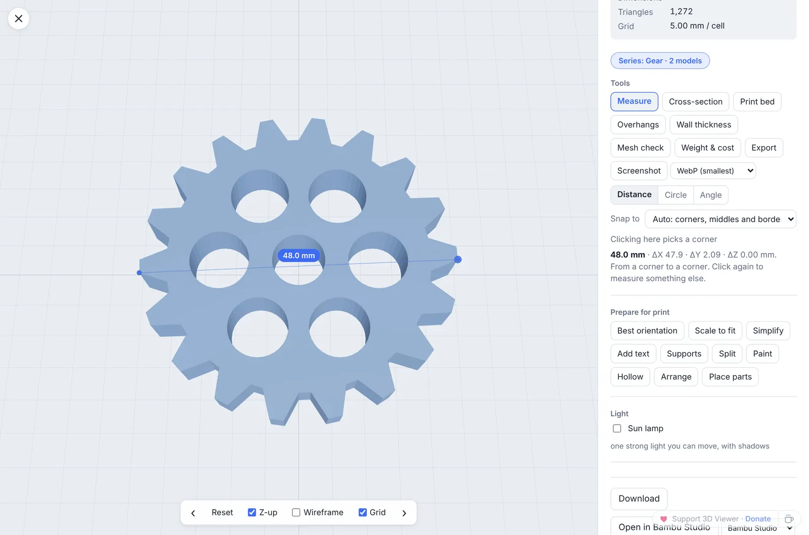
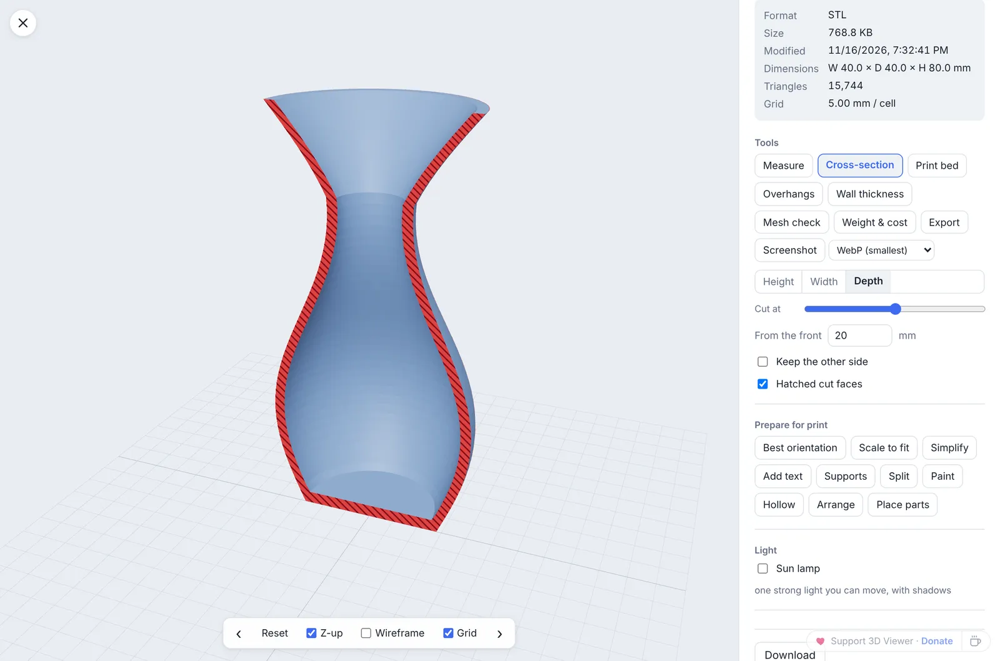
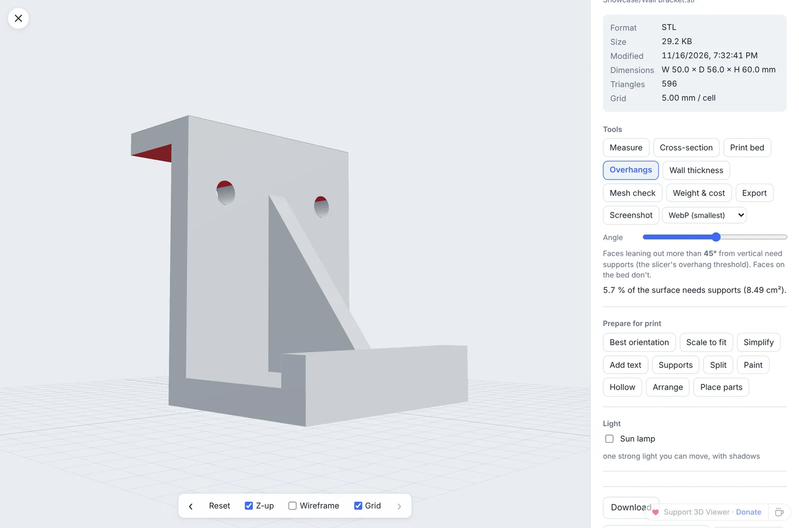
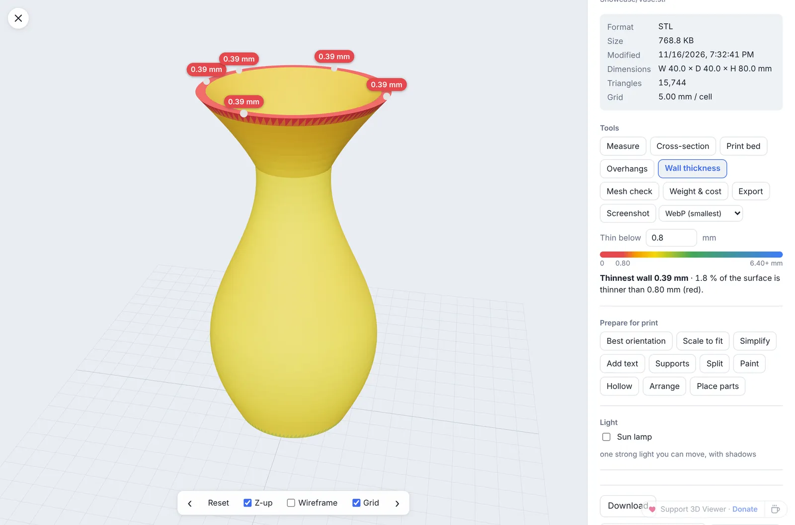
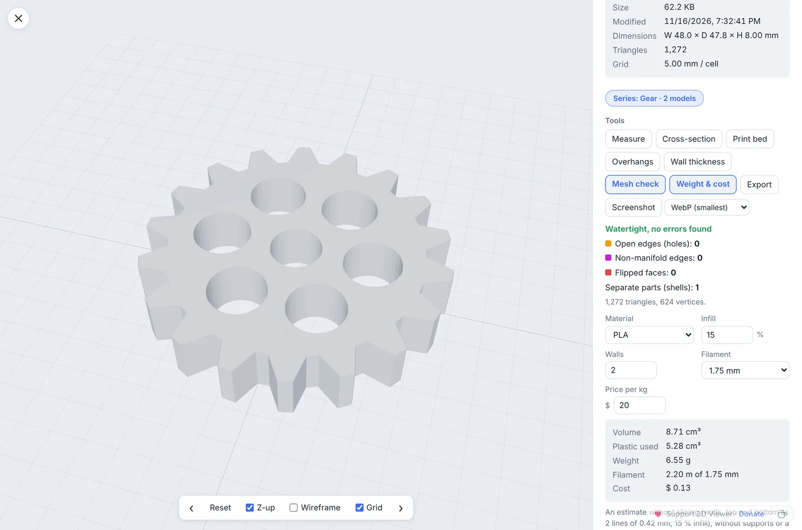
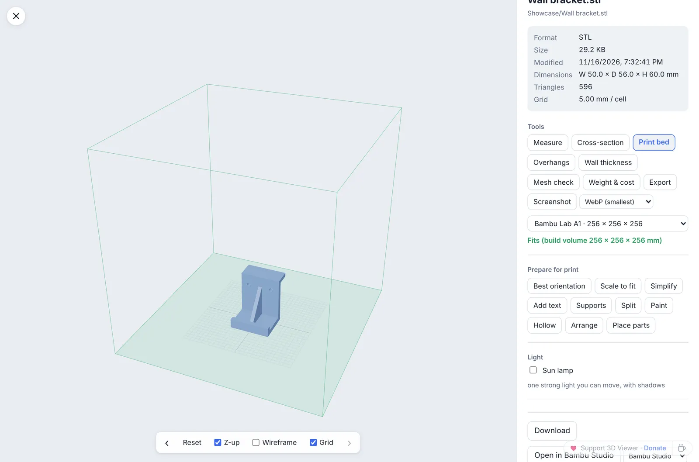

In the viewer panel under **Tools**, for everyone. They never change the model file.

## Measure

- **Distance**: two points; the distance with its ΔX, ΔY and ΔZ parts.
- **Circle**: three points on the edge of a hole or a round part; radius, diameter and centre.
- **Angle**: three points; the angle at the middle one.

In mm or inches (**Admin → Viewer → Viewer defaults → Units**). One more click starts a new measurement.

**Snap to** picks where the points go: **Auto** (a corner nearby, else the middle of a border, else the border), **Corners**, **Borders** (sharp edges), **Middle of a border**, **Centre of a flat face**, **Centre of the model**, **Centre of the model's base**, or **Nothing** (exactly where you click). A ring shows where a click will land, also just outside the model's outline. The choice is remembered and can be changed between clicks.

## Cross-section

Cut through the model across its height, width or depth, with a slider for where to cut, or type the exact height (or distance from the left side or front). **Keep the other side** flips it. The cut face is drawn in red and hatched (**Hatched cut faces**), so walls and hollow parts show.

## Overhangs

Faces that will need supports turn red. **Angle** is the slicer's overhang threshold, 45° by default. It says how much of the surface needs supports; faces on the bed don't count.

## Wall thickness

Colours the whole model by how thick its walls are: red below **Thin below** (0.8 mm by default), then orange, yellow, green and blue as they get thicker. The thinnest spots are labelled. It runs in the background, with progress, on models of up to 6 million triangles.

## Mesh check

Open edges (holes, orange), non-manifold edges (purple) and flipped faces (red), with their counts and the number of separate parts. A hollow inside a part is recognised as such.

## Weight & cost

The model's volume and, for PLA, PETG, ABS, ASA, TPU, Nylon, PC, PLA-CF or resin: the plastic used, weight, filament length (1.75 or 2.85 mm) and cost, with **Infill** and **Walls**.

It is an estimate without slicing, within about 10–15 % of a slicer, without supports. The admin sets the currency and the price per kg of each material in **Admin → Printing → Print cost**; each person can change a price for themselves in the viewer.

## Print bed

**Print bed** shows a printer's build volume around the model (Bambu Lab, Prusa, Creality, Elegoo, Anycubic, Voron, resin printers, or a custom size). It says whether the model fits, fits after a quarter turn, or by how much it is too big. The printer is remembered.

## Export

Downloads the model as **STL**, **3MF** or **OBJ**, standing on the bed as shown (with an orientation you just set, saved or not), with everything done in [Prepare for print](Prepare-for-Print).

- **Scale** in %, or a **Height** in mm.
- **Repair** (on by default) closes holes, turns flipped faces the right way and removes faces with no area and faces stored twice, then says what it fixed and what is left.
- **One file per part** after Split, Arrange or Supports: a .zip with a file per part.
- Admins can **Save a copy here**, next to the original (for example `benchy-fixed.3mf`). The original is never changed.

The file's own colours and textures are not exported; colours painted with **Paint** are.

## View in AR and Screenshot

See [Viewer](Viewer#view-in-ar).
