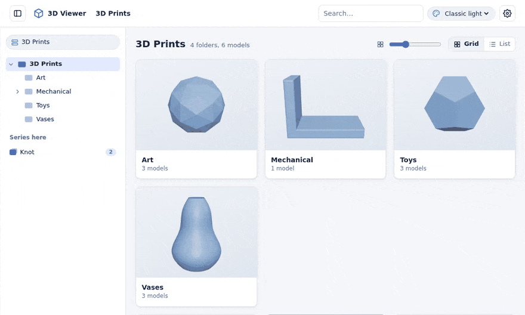
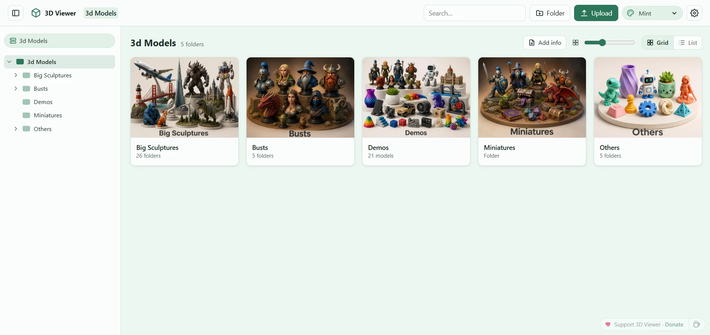

## Libraries

A library is a folder of models: a share, a volume, a USB drive or a [network share](Network-Shares-and-USB-Drives). Add as many as you like in **Admin → Library → Libraries**, and switch between them from the menu at the top of the sidebar.

## Sidebar

- A folder tree of the library: expand folders in place; the open one is highlighted.
- The series in the open folder.
- **Recently added**: the newest models of all libraries, by the date of the file.
- For signed-in people: **My favourites**, **My prints**, each of their tags, **To print** and **Statistics**.

Hide it with the button at the left of the top bar; on phones it opens as a drawer.

## Gallery

A grid or a list of the models and folders in the open folder. A slider sets the card size.

- **Sort by**: name (A–Z or Z–A), date (newest or oldest first), size or type. Remembered in your browser.
- **Show**: folders only, models only, models without a thumbnail, or one file type (for example only STL or only G-code), each with how many there are. Signed-in people can also narrow it to their favourites, prints or a tag.
- The folder title, its tools and the upload progress bar stay at the top while you scroll.
- Under its name, a folder card shows what it holds, sub-folders included (for example **12 folders · 10 models · 35 files**; files are everything that is not a model). The counts are worked out in the background and kept up to date.

## Search

The search box looks through the open folder and all its sub-folders (the whole library at the top level). It matches file names, folder names, display names, descriptions, series names and your own tags; every word you type must match.

Results show as one list, with the folder each model is in. Matching folders come first. A click opens the model in its folder; **Esc** or clearing the box goes back.

## Folder pictures

A folder card shows, in this order:

1. its own picture: a `cover`, `folder` or `preview` image inside it;
2. else its first image (also from an `images/` sub-folder);
3. else the thumbnail of the model chosen with **Use as the folder thumbnail** in the viewer;
4. else the render of its first model.

A folder that only holds sub-folders (for example `Bird/With base` and `Bird/No base`) shows the picture of its first sub-folder that has one.

### Choosing a folder's picture (admin)

Click the picture button on a folder's card, or **Picture** above the grid when you are inside it. Upload a picture, or pick a picture or model thumbnail from inside the folder or its sub-folders.

- The choice is previewed as the card shows it. **View full size** (or a click on the preview) shows the whole picture with a frame on the part the card keeps: drag the frame to choose another part, or drag its corners to resize it (it stays 4:3).
- Step through the folder's pictures with the arrows, the **← →** keys or a swipe.
- **Fit to screen** (the default) or **Actual size** (100 %, to scroll or drag around).
- **Fill** (the default) crops the picture to the card; **Fit whole picture** keeps all of it, with **Black** or **White** borders.
- **Use this picture** saves it; **Cancel** or **Esc** goes back.

The picture is cropped to 4:3, resized to **800 × 600** (never enlarged) and saved in the folder as `cover.webp` (a GIF stays `cover.gif`), replacing an earlier `cover.*`. Upload pictures of that size for the sharpest result. **Remove** deletes it, and the folder goes back to the automatic picture.

## Pictures and covers

Images next to your models (PNG, JPG, WebP, GIF, AVIF) are used as covers: `benchy.jpg` becomes the cover of `benchy.stl`.

- In the viewer you can pick any picture in the folder as the cover, or go back to the 3D render.
- The viewer shows a strip of the model's pictures (images named after it, and images named after no model, such as a download's `images/` folder). Click one to open it full size.
- Large pictures get a small cached copy for the grid.

## Series

Models whose names share a first word (`Dragon_head.stl`, `Dragon_body.stl`, `dragon-wing-L.stl`) are grouped into one stacked card automatically.

- Rename a series, ungroup it, move a model into any series (a searchable list of the folder's series, where you can also type a new name), or leave a model out of grouping.
- To choose which model's picture a series card shows, open that model and click **Use as the series thumbnail**.
- Automatic grouping can be turned off in **Admin → Viewer → Viewer defaults**.

## Info panel

A folder's `README.txt`, `notes.md` and other `.txt` or `.md` files show in a panel on the right, with Markdown formatted. A `files/` folder also shows the README of the folder above it. Notes named after a model (`benchy.txt`) show in that model's viewer panel.

Admins can edit these files, or add a `README.md` to any folder with **Add info**.

## Statistics

Signed-in people open **Statistics** in the sidebar:

- how many models and how much space;
- models added and opened, and prints logged, per month (bar charts, each also as a table);
- models by type and by library;
- the largest models, and the most opened and most printed ones.

## Themes

Pick a colour theme from the palette menu in the top bar: **Auto** (follows your system's light or dark setting), **Classic light**, **Classic dark**, the pastel **Mint**, **Lavender**, **Peach** and **Sky**, or **Dusk** (pastel accents on a dark background). The choice is saved in your browser.

## Hidden files

Files and folders whose names start with `.` or `@` are hidden, which also hides NAS system folders such as `@eaDir`. `#recycle` folders are hidden too.
