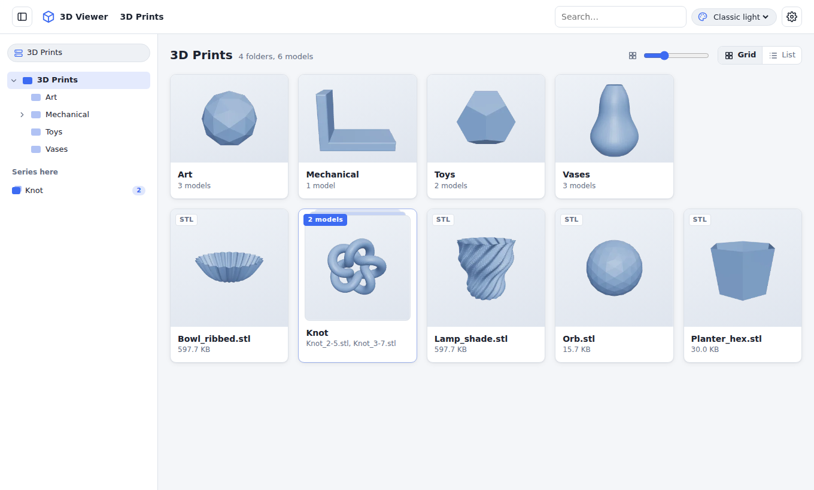

**3D Viewer** lets you browse, preview and organise the 3D models on your NAS or server from any device. It runs in Docker, is free, and your models never leave your own network.

Supported formats: STL, 3MF, OBJ, PLY, STEP/IGES, GLB/GLTF, FBX, 3DS, COLLADA, USD/USDZ, Blender, Lychee (.lys) and G-code. See [Supported formats](Supported-Formats).

## Getting started

1. [Install 3D Viewer](Installation) with Docker Compose.
2. Follow the notes for your NAS: [UGREEN, Synology, QNAP or another Linux server](NAS-Setup).
3. Open `/admin`, set the admin password and **Add library** for each folder of models.
4. Browse at `http://<nas-ip>:8733`.

## Using it

| | |
| --- | --- |
| [Gallery and browsing](Gallery-and-Browsing) | Libraries, folders, search, sorting, folder pictures, series |
| [Organising files](Organising-Files) | Upload, unpack archives, move, rename, select, download, trash |
| [Viewer](Viewer) | Turning models, orientation, light, compare, similar models, AR |
| [Check tools](Check-Tools) | Measure, cross-section, overhangs, wall thickness, mesh check, weight and cost, export |
| [Prepare for print](Prepare-for-Print) | Best orientation, scale, simplify, text, supports, split, paint, hollow, arrange |
| [Colours, materials and textures](Colours-Materials-and-Textures) | What each format shows, and how to keep textures with a model |
| [Printing](Printing) | The To print list, and sending files to Klipper, OctoPrint, PrusaLink and Bambu Lab printers |
| [Import from a link](Import-from-Link) | Printables, Thingiverse, MakerWorld and direct file links |

## People and sharing

| | |
| --- | --- |
| [Accounts and sign-in](Accounts-and-Sign-in) | Accounts, favourites, tags, print log, private server, two-factor, single sign-on |
| [Share links](Share-Links) | Links to one model or folder, for people without an account |
| [Notifications](Notifications) | Telegram, Discord, e-mail, ntfy and Gotify |
| [Home Assistant and the API](Home-Assistant-and-API) | API tokens and a Home Assistant sensor |

## Running the server

| | |
| --- | --- |
| [Admin page](Admin-Page) | A tour of every tab |
| [Configuration](Configuration) | Environment variables |
| [Network shares and USB drives](Network-Shares-and-USB-Drives) | SMB/NFS shares and external drives as libraries |
| [Reverse proxy and HTTPS](Reverse-Proxy-and-HTTPS) | Caddy, Nginx, Nginx Proxy Manager, Traefik |
| [GPU rendering](GPU-Rendering) | Faster thumbnails with the NAS's Intel GPU |
| [Thumbnails and previews](Thumbnails-and-Previews) | Background rendering, the cache and `CACHE_DIR` |
| [Size limits](Size-Limits) | Upload, unpack and thumbnail limits |
| [Backups](Backups) | Settings backups, automatic backups, moving to a new NAS |
| [Updating](Updating) | New versions and pinning one |
| [Troubleshooting](Troubleshooting) | Logs and common problems |

## More

- [FAQ](FAQ)
- [Languages and translations](Languages-and-Translations)
- [Install as an app](Install-as-an-App)
- [Supporter key](Supporter-Key): 3D Viewer is free; a donation turns off the splash screen.
- [Releases](https://github.com/VincentFlagg/3DViewer/releases) and [CHANGELOG](https://github.com/VincentFlagg/3DViewer/blob/main/CHANGELOG.md)
- Questions and ideas: [Discussions](https://github.com/VincentFlagg/3DViewer/discussions). Bugs: [Issues](https://github.com/VincentFlagg/3DViewer/issues/new/choose).
