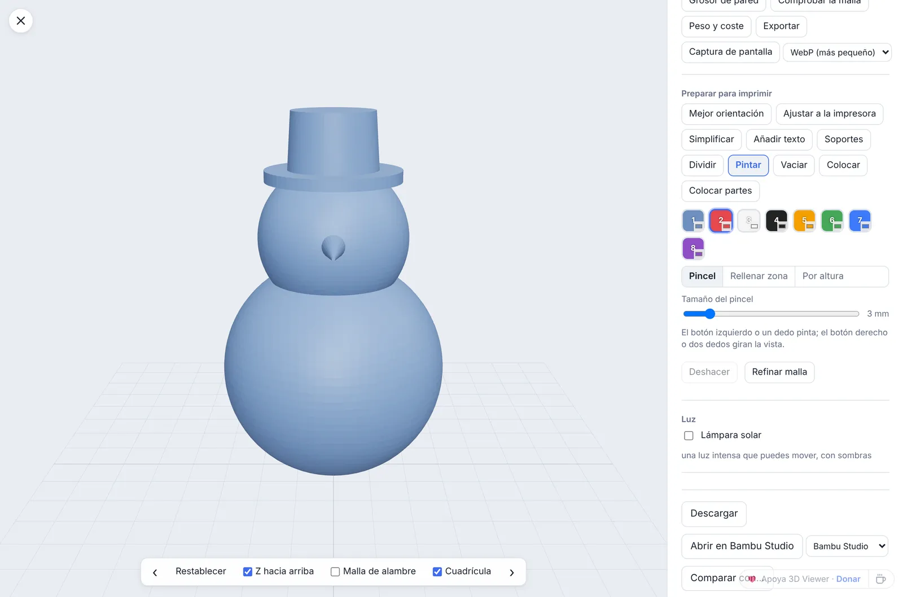

3D Viewer is in **English** and **Spanish** (Español).

- It follows your browser's language.
- The globe button at the top changes it for this browser.
- Names, descriptions and notes stay as they were written.

More languages can be added without a new feature release: each language is one file of texts.

## Help with translations

- **A wrong or clumsy translation?** [Open a translation issue](https://github.com/VincentFlagg/3DViewer/issues/new?template=translation.yml) with the text as it is now, where you saw it, and how it should read.
- **3D Viewer in your language?** Open a translation issue and say which language. To translate it yourself, open `http://<your-server>/i18n/es.json` from your own 3D Viewer: it lists every English text with its Spanish translation. Write yours in place of the Spanish ones and attach the file to the issue.
- **A text still in English?** In the browser's developer console, `__i18nMissing()` lists the texts on the page that have no translation yet. Paste them into the issue.

Everyone who helps is thanked in the release notes.
