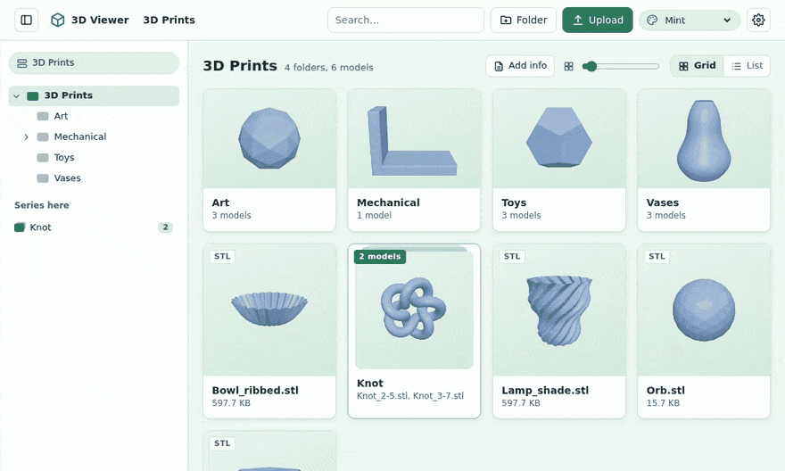

Viewing and downloading are open to everyone (unless the server is [private](Accounts-and-Sign-in#private-server)). **Changes need the admin**: upload, new folder, rename, move, delete, restore from the trash, and editing names, descriptions and series. Signed-in accounts can also [import from a link](Import-from-Link), [make share links](Share-Links) and add their own tags.

The admin can turn all editing off in **Admin → Accounts → Access & editing**, or lock it with `READ_ONLY=true`.

## Upload

- Drag files or folders onto the page, or use **Upload** (**Upload a folder…** for a folder). The folder structure is kept.
- Files larger than the upload limit are skipped before uploading, with a message. See [Size limits](Size-Limits).

## Archives

Uploading an archive unpacks it into a new folder named after it (a single top-level folder inside it is dropped) and removes the archive. Supported:

- `.zip`, also protected with a password;
- `.rar` (RAR4 and RAR5), also split into parts (`Name.part1.rar`, `Name.part2.rar`… or `Name.rar`, `Name.r00`…);
- `.7z`, also split (`Name.7z.001`, `Name.7z.002`…);
- `.tar`, `.tar.gz`/`.tgz`, `.tar.xz`/`.txz`, `.tar.bz2`/`.tbz2`;
- a single compressed file (`model.stl.gz`, `.xz`, `.bz2`), unpacked next to it as `model.stl`.

An archive with a password, a split archive (its parts may arrive in separate batches) or one that cannot be unpacked is kept as it is: unpack it from its card. For safety, archives with links or with paths outside their folder are not unpacked.

### Archives already in a library

An archive with models inside that was copied into a library (over SMB, for example) shows as a card with its type (ZIP, RAR, 7Z, TAR, GZ), how many models it holds and, for a split archive, how many parts it has.

- **Unpack** (admin) unpacks it like an upload, into a new folder named after it; the archive (all its parts) goes to the trash. For an archive with a password, **Unpack** asks for it (it is not kept).
- Select several archives and click **Unpack** in the selection bar to unpack them one after another.
- **Admin → Library → Unpack archives** does this for every archive with models in a library, sub-folders included (archives with a password are left for you).
- One archive is unpacked at a time, so an archive is never unpacked twice.
- Archives without models are not shown. The unpacked size limit is in **Admin → Thumbnails → Limits**.

## Selecting several models and folders

Click **Select** above the grid (or **Ctrl/Cmd+click** a card):

- click to add or remove one, **Shift+click** for a range, **Select all** for everything in the folder, sub-folders included;
- a series card selects all its models.

The bar at the bottom shows how many are selected and their size, with:

| Button | |
| --- | --- |
| **Download** | One .zip of the selected files and folders, keeping their sub-folders. No size limit; it is streamed. OBJ and GLTF models bring the files they need (`.mtl`, textures, `.bin`). A single file downloads as it is. |
| **Compare** | With two models: side by side or on top of each other. See [Viewer](Viewer#compare). |
| **Arrange…** | Several models packed on one printer plate. See [Prepare for print](Prepare-for-Print#arrange). |
| **Edit…** | Set or clear the series, replace or add to the description, set the licence (admin), and add or remove your own tags. |
| **Unpack** | Archives, one after another. |
| **Move to…**, **Delete** | Admin only. |

## Moving

Admins drag a model, a series card, a folder or a selection onto:

- a folder card;
- a folder in the sidebar tree;
- a breadcrumb link;
- another library: while you drag, the sidebar lists the other libraries.

Or use **Move to…** (on a folder card, in the viewer and in the selection bar) to pick a library and folder. **New folder** in that picker creates a folder where you are and opens it.

- A model takes its notes, saved orientation, thumbnail and same-name companions (an OBJ's `.mtl`, `benchy.jpg`, `benchy.txt`) along.
- Between libraries on the same disk a move is instant; to another disk or share it is copied and then deleted, with a progress bar.
- When the name is already taken, you are asked before replacing it (the one replaced goes to the trash).
- Favourites, tags and share links follow a model when it is moved or its folder is renamed in the app.

## Renaming

- **Folders**: the pencil button on a folder's card, or **Rename** above the grid for the folder you are in. Its models keep their notes, saved orientation, thumbnails and previews.
- **Models**: the display name and description are edited in the viewer. The file name stays as it is.

## Trash

Deleting a file or a folder (with everything in it) moves it to a hidden `.3dviewer-trash` folder in its library, with its notes and orientation.

- **Admin → Library → Trash** lists the items, restores them where they were, or deletes them for good.
- Items older than 30 days are deleted for good automatically (Admin setting; 0 = keep until emptied).
- Deleting for good cannot be undone: the NAS recycle bin does not catch it, and other users, apps and slicers lose the files too.

## Duplicates

**Admin → Library → Duplicates** finds models stored more than once, in any folder or library (the same contents, whatever their names), with **Keep only this one** and **Delete** to send the extra copies to the trash.

## Names, descriptions and licence

Each model can have a display name, a description, a series and a licence (for example CC BY-NC 4.0), shown in the viewer. They are stored next to the model in a `.3dviewer/` folder, so they move with it:

```
Prints/
├── benchy.stl
└── .3dviewer/
    └── benchy.stl.json   { "title": "...", "description": "...", "group": "..." }
```
