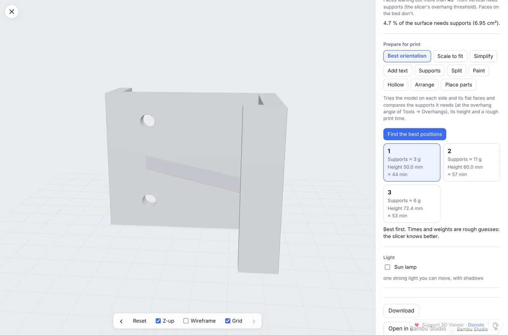
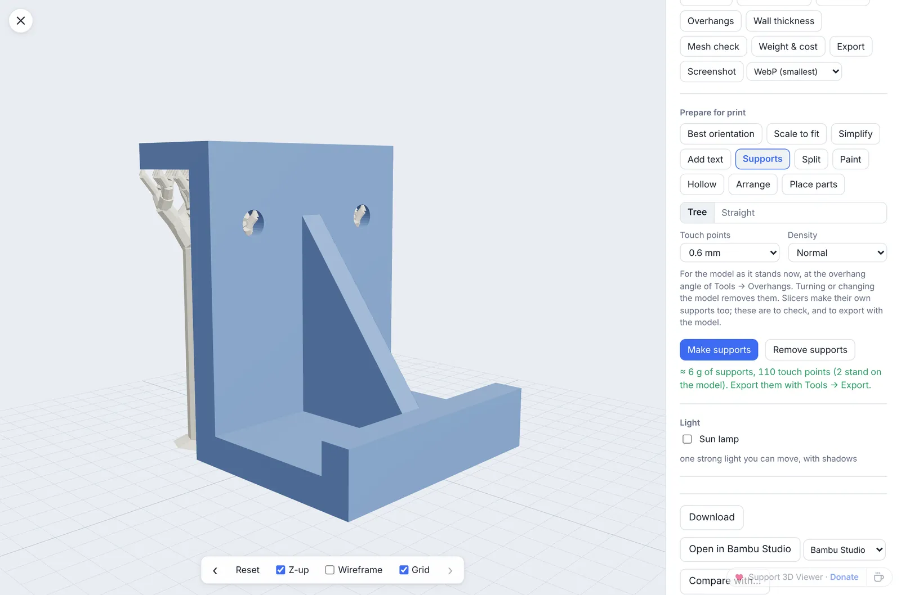
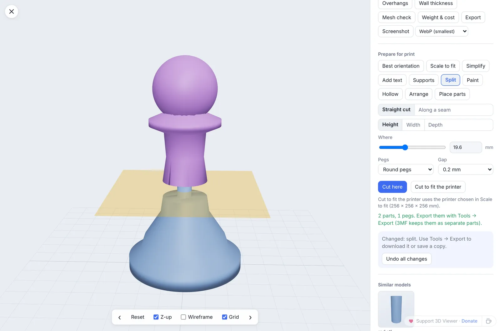
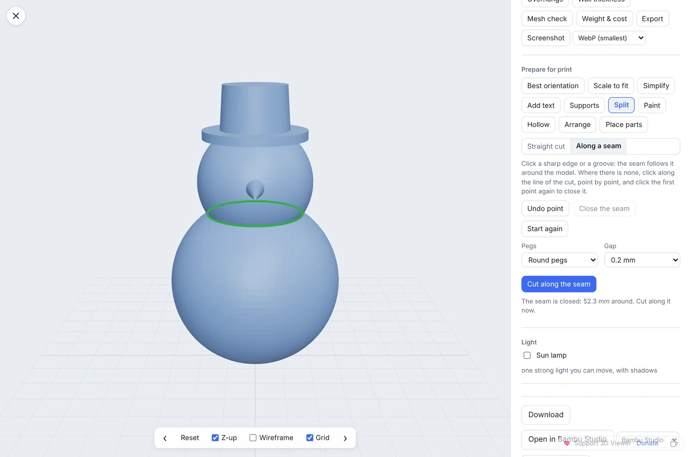
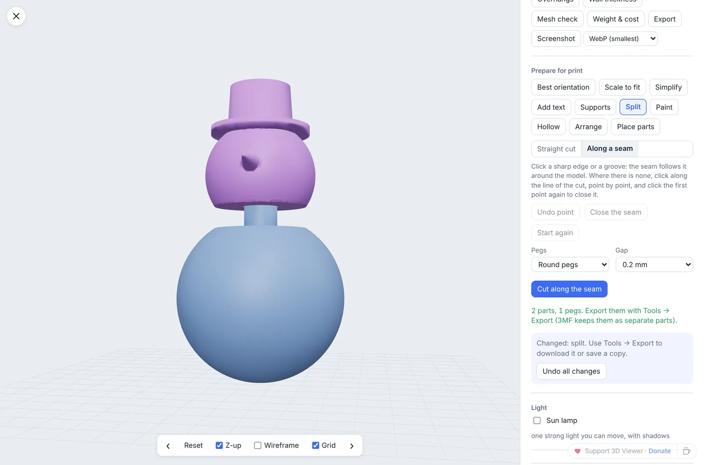
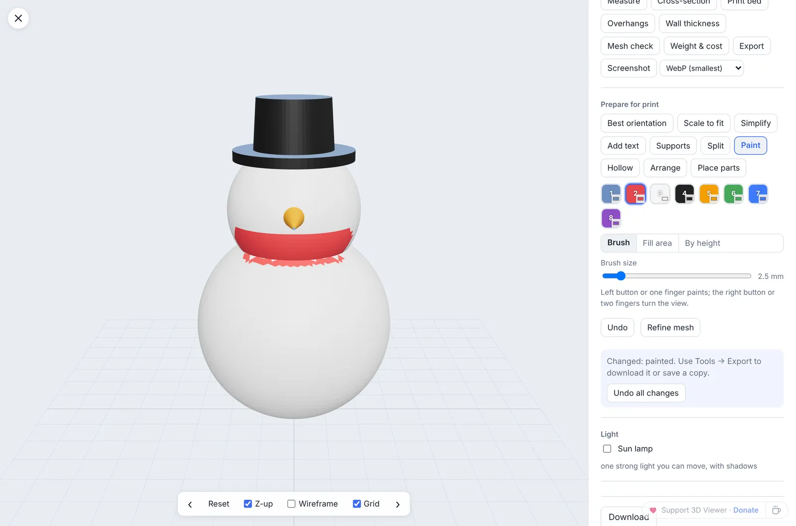
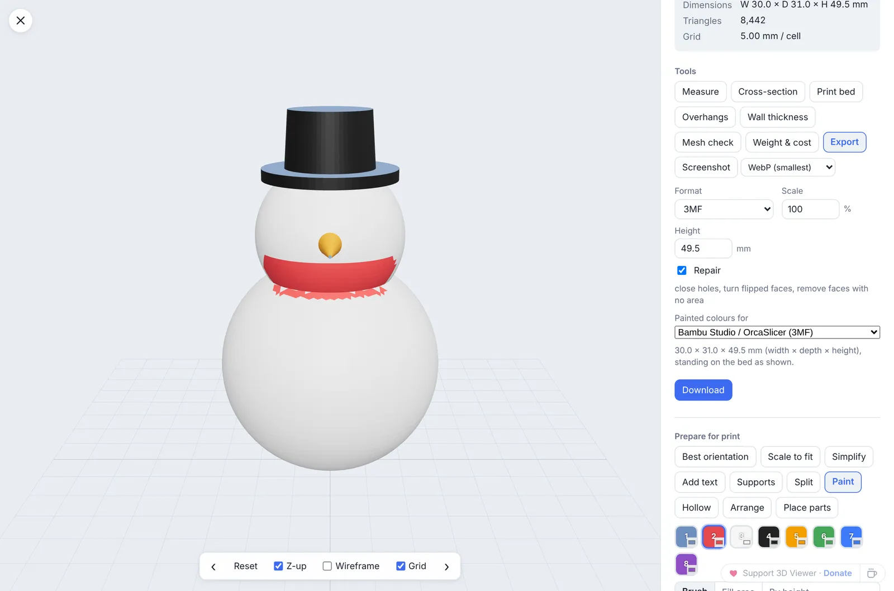
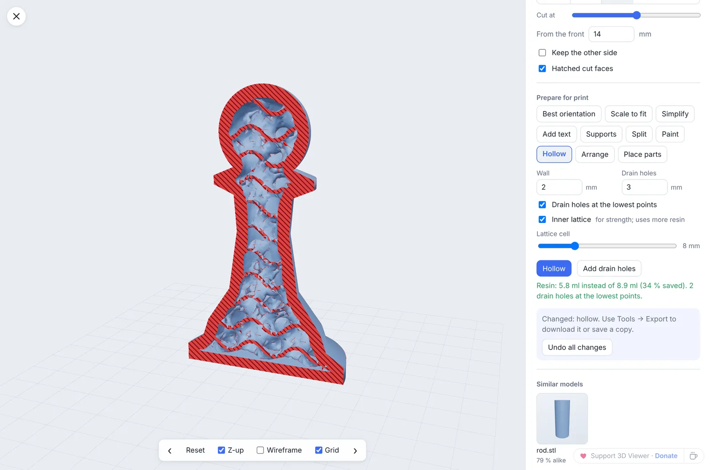
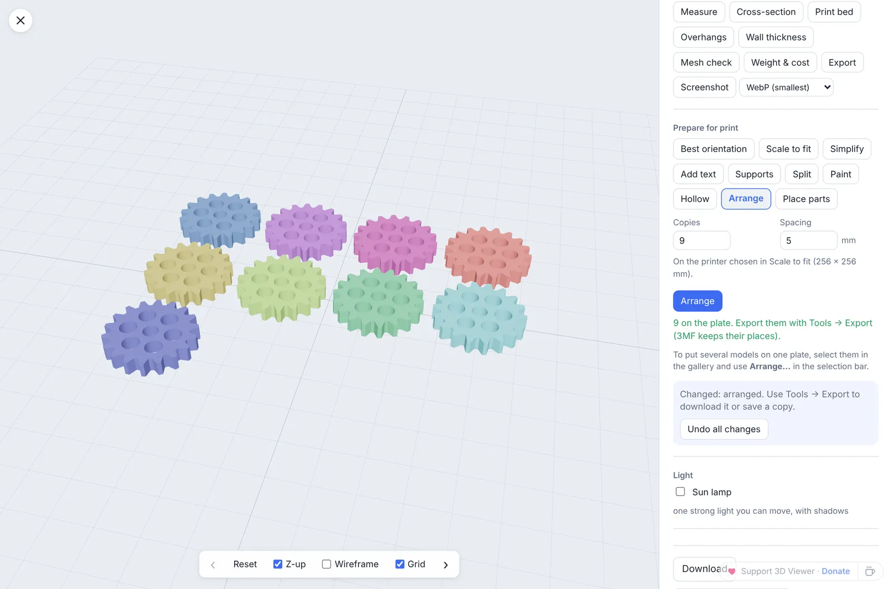
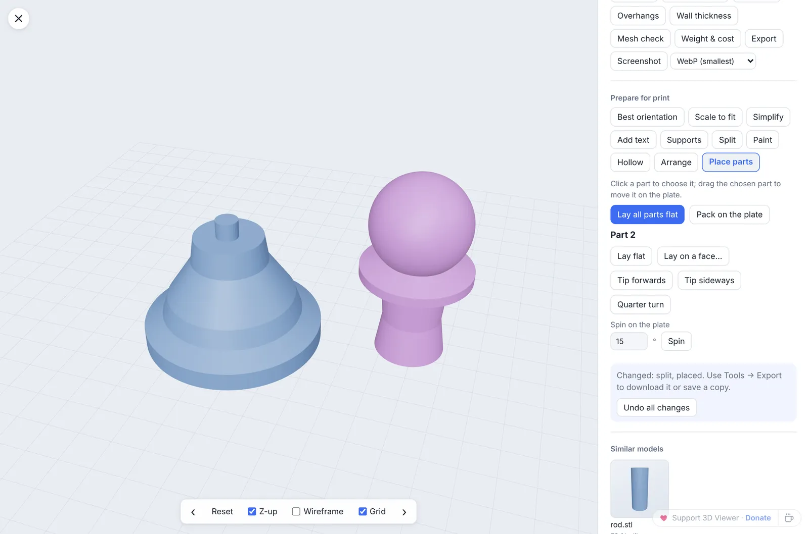

Under **Prepare for print** in the viewer panel, for everyone. Everything runs in the browser, and the model file is never changed:

- download the result with **Tools → Export** ([Check tools](Check-Tools#export));
- or, as the admin, **Save a copy here**, next to the original;
- **Undo all changes** goes back to the model as it was.

## Best orientation

Tries the model on each side and on its flat faces, and shows the three best positions, each with an estimate of its supports (in grams), its height and a rough print time. Click one to turn the model; the faces that need supports turn red. The admin keeps a position with **Save orientation**.

## Scale to fit

For the chosen printer: how big the model can be with 5 % of the build volume left free (turned a quarter turn on the bed when that fits better). **Use … % for the export** sets the export scale.

## Simplify

Keeps 10–90 % of the triangles (50 % by default), for a lighter file that slices faster, and says how far the surface moved at most.

## Add text

Type the text, pick a font, the letter height and the depth, **Raised** or **Engraved**, and click the model where it goes. It reads upright from where you look. Text on a curved face reaches the surface everywhere. Several texts can be added.

## Supports

- **Tree** (branches that join into trunks: less plastic, fewer marks) or **Straight** (a column under each spot).
- Under every overhang, at the angle set in **Tools → Overhangs**.
- **Touch points** of 0.4–1.0 mm and a **Density**.
- Shows how much plastic they take, and how many stand on the model.

Export saves them with the model as their own part (in a 3MF, or a file of their own with **One file per part**). They are for the model as it stands: turn it first. Your slicer can still make its own supports instead.

## Split

Cut the model across its height, width or depth wherever you like (drag the cut or type it in mm), or **Cut to fit the printer** chosen in Scale to fit: as few cuts as make every part fit.

The parts are joined with:

- **Round pegs**;
- **Keyed pegs**, with a flat side, so they fit one way only;
- **Dowel holes**: holes in both parts, and loose dowels to print (or use metal pins or magnets);
- **No pegs**.

**Gap** is 0.1–0.4 mm. The parts show apart, each in its own colour. Export saves them as one 3MF with each part separate, or **One file per part** in a .zip.

### Along a seam

Click a sharp edge or a groove and the seam follows it around the model. Where there is none, click along the line of the cut, point by point, and click the first point again (or **Close the seam**) to close it.

The model is cut along that line, with a smooth surface across it and the same pegs, all pointing one way so the parts slide together.

- A seam has to go all the way around a part; cut again for more parts.
- Where a smooth cut would pass through a hollow or outside the model, each side keeps what is nearest to it instead (an uneven cut inside, without pegs).

## Paint

Paint the model in up to 8 filament colours, for multi-colour printers (AMS, MMU, toolchangers).

- **Brush** paints where you drag (left button or one finger; the right button or two fingers turn the view).
- **Fill area** fills a whole area up to sharp edges and other colours.
- **By height** paints everything above or below a height.
- **Undo** goes back one step. **Refine mesh** splits large triangles so painted borders follow the brush.

Export saves the colours as:

- a 3MF for **Bambu Studio / OrcaSlicer**;
- a 3MF for **PrusaSlicer**;
- a **Coloured 3MF** for other slicers;
- **One part per colour**: the model cut into closed parts, one per colour, that fill it exactly and stay in place (borders follow the paint to within a few tenths of a millimetre), as one object of coloured parts in a 3MF, or a .zip of STL files.

As the admin, **Save painting** keeps the painting with the model: it shows for everyone who opens it, until the model file changes or you use **Remove saved painting**.

## Hollow

For resin printing:

- a **Wall** of 0.8–10 mm (approximate, within a few tenths of a millimetre);
- **Drain holes** of 1–10 mm at the lowest points, or where you click with **Add drain holes**;
- an optional **Inner lattice** for strength.

It shows how much resin the model takes before and after.

## Arrange

Copies of the model (or of its parts, after Split) packed on the plate of the printer chosen in Scale to fit, with the **Spacing** you choose.

To put several different models on one plate, select them in the gallery and click **Arrange…** in the selection bar, with the number of copies of each. Export saves them in their places in a 3MF.

## Place parts

After Split or Arrange, click a part to choose it, then:

- **Lay flat**: on its largest flat face that can rest on the plate, usually the cut;
- **Lay on a face…**: click the face that goes down;
- **Tip forwards**, **Tip sideways**, **Quarter turn**, or **Spin** by any angle;
- drag the chosen part to move it on the plate.

**Lay all parts flat** does every part at once and packs them side by side; **Pack on the plate** packs them as they lie. A part whose only flat face has a peg on it is left as it is.

Export saves the parts as they are placed (3MF), or one file per part.
