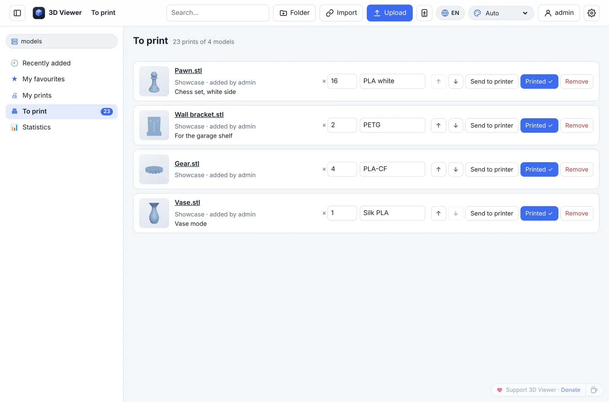

## Who can print

The admin ticks **Can print** for each account allowed to use the To print list and the printers, in **Admin → Accounts → Accounts**.

## To print

A shared list of what to print next.

- **+ To print** in the viewer adds a model with how many copies, the material and a note.
- The list is in the sidebar, with a count. Reorder it, and change the copies, material or note in place.
- **Printed ✓** counts one copy off and adds it to your [print log](Accounts-and-Sign-in#your-own-marks).
- Sliced files can be sent to a printer from the list.

## Send to printer

Sliced files (G-code, `.bgcode` or a sliced 3MF) can be sent to a 3D printer on your network from the viewer or the To print list, and started right away if you like. Each printer shows whether it is free or printing.

| Printer | How it connects | What you need |
| --- | --- | --- |
| **Klipper** (Mainsail, Fluidd) | Moonraker | The printer's address |
| **Creality** K1, K2, Hi, Ender-3 V3 | Moonraker | Moonraker reachable (rooted, or firmware that opens it) |
| **OctoPrint** | OctoPrint API | An API key |
| **Prusa** MK4, XL, MINI, Core One | PrusaLink | The user and password from the printer, or an API key |
| **Bambu Lab** X1, P1, A1 | LAN mode | IP address, serial number and LAN access code |

For Bambu Lab printers, send a 3MF saved with **Export plate sliced file** in Bambu Studio or OrcaSlicer.

### Add a printer

**Admin → Printing → Printers → Add a printer**: pick the type, enter the details, and **Test connection**. Printers can be changed, tested and removed there too.

## Print cost

The **Weight & cost** tool in the viewer uses the currency and the price per kg of each material set in **Admin → Printing → Print cost**. See [Check tools](Check-Tools#weight--cost).

## Getting models to the slicer

- **Open in slicer** in the viewer opens a model in Bambu Studio, OrcaSlicer, PrusaSlicer, Creality Print or UltiMaker Cura on your computer. See [Viewer](Viewer#open-in-slicer).
- [Prepare for print](Prepare-for-Print) turns, cuts, paints and arranges models before you slice.
