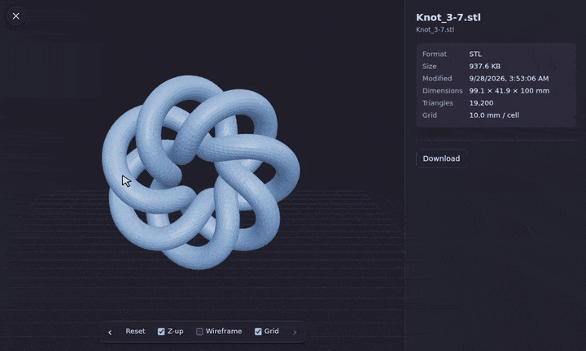
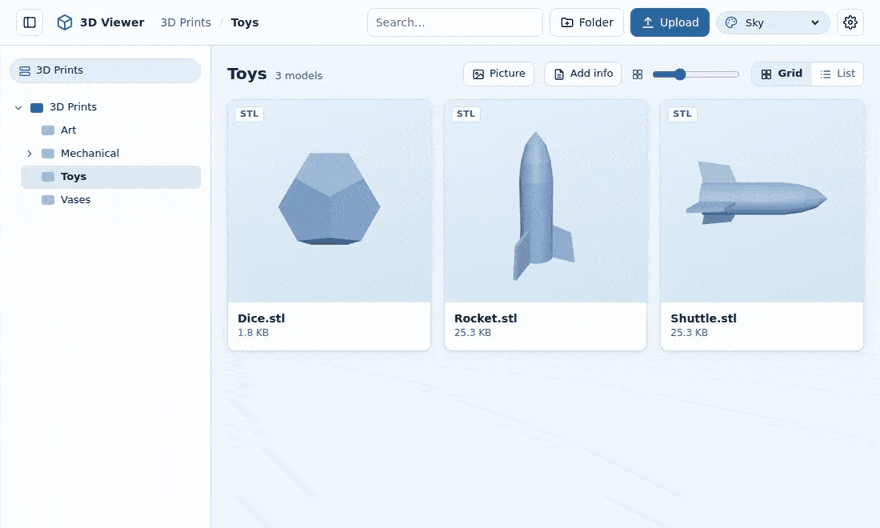

Click a model to open it. The viewer panel on the right has its details, the tools and the actions.

## Moving around

- **Orbit**: drag with the left button or one finger.
- **Pan**: drag with the right button or two fingers.
- **Zoom**: the mouse wheel or a pinch.
- The toolbar has **Z-up**, **wireframe**, the ground **grid** and **reset view**.

The panel shows the dimensions as **W** (width, left to right) × **D** (depth, front to back) × **H** (height, bottom to top), as the model stands, and the triangle count. Dimensions assume the model is in millimetres; choose inches in **Admin → Viewer → Viewer defaults**.

## Orientation

Models open Z-up, seen from the front; thumbnails use the same view. Which formats open Z-up is set in **Admin → Viewer → Viewer defaults**, and the toolbar toggle changes it for one model.

If a model still lies on its side or faces away, admins can fix it:

- **Tilt**, **Turn** and **Roll**: quarter turns.
- **Lay flat on a face**: turns the model onto the face you click next.
- **Auto-orient for printing**: tries the model on each of its flat sides and keeps the one that needs the fewest supports (at the **Overhangs** angle), then the largest footprint.
- **Save orientation**: it then always opens that way, and its thumbnail is rendered again.

The orientation is stored in the model's `.3dviewer` metadata; the model file itself is never changed.

## Thumbnail view

To show a model from another angle in its thumbnail, admins turn the view with the mouse (or a finger) and click **Use this view**. The thumbnail is rendered again from that angle, and the model opens from it. **Front view** goes back to the standard view and even light.

Also in the panel: **Use as the folder thumbnail** and **Use as the series thumbnail**.

## Light

**Light → Sun lamp** replaces the even lighting with one strong light that casts shadows on the model and the floor, which brings out shape and fine detail.

- **Front**, **Left**, **Right**, **Back** and **Top** move it; **Around** and **Height** set any direction.
- The setting is remembered in your browser.
- Click **Use this view** while it is on to give the thumbnail the same light and shadows.

## Compare

Select two models in the gallery and click **Compare**, or use **Compare with…** in the viewer and pick the second one from the folder or search the library.

- **Side by side**: on one floor and at the same scale, with the size of each.
- **Overlay**: on top of each other, each in its own see-through colour, to see what differs (for example two versions of a part).

Measure, cross-section, print bed and screenshot work there too.

## Similar models

The viewer lists models from the whole library that look like the open one, with how alike they are in %: copies saved under another name, other versions and remixes. The server works out the shape of every model in the background, after the thumbnails. It does not depend on names, size, position or how a model is turned.

## 3MF plates and colours

For 3MF projects from Bambu Studio, OrcaSlicer and PrusaSlicer, the viewer lists the plates (one at a time or all) and the filament colours with their material, and colours the objects as the slicer does. For large models it first shows the compressed preview: **Show plates and colours** loads the full file.

## Pictures and notes

- A strip of the model's pictures; click one to open it full size, or use one as the cover.
- Notes named after the model (`benchy.txt`) show in the panel.
- Display name, description, series and licence (editable by the admin).
- For signed-in people: **☆ Favourite**, tags under **Mine**, the print log and **+ To print**. See [Accounts and sign-in](Accounts-and-Sign-in).

## Open in slicer

For STL, 3MF, OBJ, PLY and STEP files, **Open in Bambu Studio** opens the model in the slicer installed on your computer. Pick another slicer in the list next to the button (OrcaSlicer, PrusaSlicer, Creality Print 6 or later, UltiMaker Cura); it is remembered.

The slicer downloads the file from 3D Viewer itself, so it has to reach the server at the address in your browser.

## View in AR

On phones and tablets, **View in AR** shows the model at its real size on your table or floor, through the camera.

- **iPhone and iPad** open it in AR Quick Look.
- **Android** opens Google's Scene Viewer, which downloads the model from this server: the phone must reach the server at its address, and Scene Viewer may need HTTPS.

## Screenshot

**Screenshot** saves the view as a picture: **WebP** (smallest, the default), **JPG** or **PNG** (best quality). The choice is remembered. Browsers that cannot write WebP (Safari) save a JPG.

## Tools

The **Tools** and **Prepare for print** sections of the panel are described in [Check tools](Check-Tools) and [Prepare for print](Prepare-for-Print).

## Keyboard

- **← →**: the previous or next model in the folder.
- **R**: reset the view.
- **Esc**: close the viewer.
- In the gallery, **Esc** leaves selection mode or clears the search.
